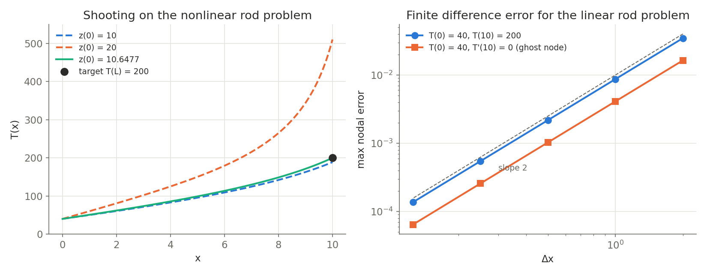

# 24장 — 경계값 문제

[레포지토리 안내](../../README.ko.md) | [English](Concepts_Lecture.md) | [한국어](Concepts_Lecture.ko.md)

> **최종 수정일:** 2026-11-27
>
> Applied Numerical Methods with Python for Engineers and Scientists, Chapra and Clough, Ch 24

> **학습 목표:**
> 1. ODE의 경계값 문제를 공식화할 수 있다
> 2. 선형 BVP의 해석해를 동차해와 특수해의 합으로 구할 수 있다
> 3. 사격법과 유한 차분법을 적용할 수 있다
> 4. BVP 풀이의 정확도와 수렴을 분석할 수 있다
> 5. 비선형 BVP를 할선법을 결합한 사격법으로 풀고 도함수 경계 조건을 가상 노드로 처리할 수 있다
> 6. SciPy의 solve_bvp로 BVP를 풀고, 비선형 BVP에 유한 차분법과 Newton 방법을 적용할 수 있다

---

<br>

## 목차

- [1. 경계값 문제(BVP) 소개](#1-경계값-문제bvp-소개)
  - [1.1 동기 부여 예제: 가열된 막대](#11-동기-부여-예제-가열된-막대)
  - [1.2 지배 방정식](#12-지배-방정식)
  - [1.3 BVP vs. IVP](#13-bvp-vs-ivp)
  - [1.4 열 수지로부터의 지배 방정식](#14-열-수지로부터의-지배-방정식)
- [2. 해석해](#2-해석해)
  - [2.1 지배 방정식 재정리](#21-지배-방정식-재정리)
  - [2.2 동차해(Homogeneous Solution)](#22-동차해homogeneous-solution)
  - [2.3 특수해(Particular Solution)](#23-특수해particular-solution)
  - [2.4 전체(일반)해](#24-전체일반해)
  - [2.5 경계 조건으로부터 상수 결정](#25-경계-조건으로부터-상수-결정)
- [3. 사격법(Shooting Method, 24.2절)](#3-사격법shooting-method-242절)
  - [3.1 핵심 아이디어: BVP를 IVP로 변환](#31-핵심-아이디어-bvp를-ivp로-변환)
  - [3.2 2차 ODE를 두 개의 1차 ODE로 변환](#32-2차-ode를-두-개의-1차-ode로-변환)
  - [3.3 추정 절차](#33-추정-절차)
  - [3.4 알고리즘 요약](#34-알고리즘-요약)
  - [3.5 Python 구현](#35-python-구현)
  - [3.6 비선형 문제의 사격법](#36-비선형-문제의-사격법)
  - [3.7 도함수 경계 조건이 있는 사격법](#37-도함수-경계-조건이-있는-사격법)
  - [3.8 대류 경계 조건의 사격법](#38-대류-경계-조건의-사격법)
- [4. 유한 차분법(Finite Difference Methods, 24.3절)](#4-유한-차분법finite-difference-methods-243절)
  - [4.1 핵심 아이디어: 영역의 이산화](#41-핵심-아이디어-영역의-이산화)
  - [4.2 2계도함수 근사](#42-2계도함수-근사)
  - [4.3 유한 차분 방정식 생성](#43-유한-차분-방정식-생성)
  - [4.4 미지수와 방정식 개수 세기](#44-미지수와-방정식-개수-세기)
  - [4.5 삼중대각 시스템 조립](#45-삼중대각-시스템-조립)
  - [4.6 행렬 공식화](#46-행렬-공식화)
  - [4.7 Python 구현](#47-python-구현)
  - [4.8 도함수 경계 조건과 가상 노드](#48-도함수-경계-조건과-가상-노드)
  - [4.9 격자 세분과 수렴 차수](#49-격자-세분과-수렴-차수)
  - [4.10 SciPy의 solve_bvp](#410-scipy의-solve_bvp)
  - [4.11 비선형 BVP의 유한 차분법과 Newton 방법](#411-비선형-bvp의-유한-차분법과-newton-방법)
  - [4.12 사격법과 유한 차분법의 정확도와 비용](#412-사격법과-유한-차분법의-정확도와-비용)
  - [4.13 대류 경계 조건의 유한 차분 처리](#413-대류-경계-조건의-유한-차분-처리)
  - [4.14 비선형 유한 차분 방정식의 연속 대입](#414-비선형-유한-차분-방정식의-연속-대입)
- [5. 흔한 실수](#5-흔한-실수)
- [개념 적용](#개념-적용)
- [요약](#요약)
- [점검 문제](#점검-문제)
- [참고 문헌](#참고-문헌)

---

<br>

## 1. 경계값 문제(BVP) 소개

### 1.1 동기 부여 예제: 가열된 막대

두 개의 일정 온도 벽 사이에 놓인 길고 가는 막대의 **정상 상태 온도 분포**를 고려한다:

- 왼쪽 벽은 온도 $`T_a`$로 유지된다.
- 오른쪽 벽은 온도 $`T_b`$로 유지된다.
- 주변 공기 온도는 $`T_\infty`$이다.
- 막대의 길이는 $`L`$이다.

```text
                 주변 공기 T∞
 ┃   ↕    ↕    ↕    ↕    ↕    ↕    ↕    ↕   ┃   ↕ 대류
 ┃██████████████████████████████████████████┃   ◀─▶ 전도(막대 방향)
T_a                                        T_b
 ├──────────────────────────────────────────┤──▶ x
 0                                          L
```

*그림 1. 두 벽 사이에 놓인 가열된 막대의 전도와 대류*

막대에 두 가지 열전달 메커니즘이 작용한다:

| 메커니즘 | 방향 | 설명 |
|:----------|:----------|:------------|
| **전도(Conduction)** | 막대 방향 (수평) | 막대 재료를 통해 한쪽 끝에서 다른 쪽으로 열이 흐름 |
| **대류(Convection)** | 막대에 수직 (수직) | 막대 표면과 $`T_\infty`$ 온도의 주변 공기 사이에서 열이 교환됨 |

*표 1. 가열된 막대에 작용하는 두 열전달 메커니즘*

기본적인 질문은 다음과 같다: **막대를 따른 온도 분포 $`T(x)`$는 무엇인가?**

온도 $`T(x)`$는 $`x = 0`$에서 $`T_a`$부터 $`x = L`$에서 $`T_b`$까지 변하며, 이 끝점들 사이의 프로파일은 전도와 대류의 균형에 의존한다.

> **참고:** **물리 배경.** 전도는 Fourier 법칙을 따르며 막대 재료의 열전도도에 의존한다. 대류는 막대 표면과 주변 유체 사이의 열전달 계수에 의존한다. 지배 방정식의 매개변수 $`h'`$는 대류 효과와 전도 효과의 상대적 크기를 나타낸다.

### 1.2 지배 방정식

막대를 따른 열전도와 주변 공기로의 대류를 함께 나타내는 지배 방정식은 다음과 같다:

```math
0 = \frac{d^2 T}{dx^2} + h'(T_\infty - T) \quad \cdots (**)
```

**경계 조건**은 다음과 같다:

```math
T(x = 0) = T_a, \quad T(x = L) = T_b
```

여기서 $`h'`$는 대류 열전달 계수, 막대의 기하 형상, 열전도도와 관련된 매개변수이다.

영역의 끝점에서 두 개의 경계값이 주어지면, 온도 분포 $`T(x)`$를 풀 수 있다.

### 1.3 BVP vs. IVP

| 특성 | 초기값 문제(IVP) | 경계값 문제(BVP) |
|:--------|:---------------------------|:-----------------------------|
| **조건이 주어지는 곳** | 단일 점 ($`x = x_0`$) | 둘 이상의 서로 다른 점 |
| **전형적인 조건** | $`y(x_0) = y_0`$, $`y'(x_0) = y'_0`$ | $`y(a) = \alpha`$, $`y(b) = \beta`$ |
| **풀이 접근법** | $`x_0`$에서 앞으로 전진 | 한쪽 끝에서 단순히 전진할 수 없음; 반복 추정(사격법)이나 전역 풀이(유한 차분법) 필요 |
| **차수** | $`n`$차 ODE에 한 점에서 $`n`$개의 조건 필요 | 조건이 경계에 걸쳐 분산됨 |

*표 2. 초기값 문제와 경계값 문제의 비교*

> **용어 정의:** **경계값 문제(boundary value problem)** 는 미분방정식의 해에 대한 조건이 구간의 서로 다른 점, 보통 양 끝점에서 나누어 주어지는 문제이다. 같은 방정식이라도 경계 조건에 따라 해가 하나이거나, 없거나, 무수히 많을 수 있다(4.9절).

> **[미적분학]** 2차 ODE의 해를 하나로 정하려면 일반적으로 두 개의 조건이 필요하다. IVP에서는 두 조건이 같은 점에서 주어지고(예: $`t = 0`$에서 위치와 속도), BVP에서는 다른 공간 위치에서 주어진다(예: 막대 양쪽 끝의 온도). 계수가 연속인 선형 IVP는 해가 하나로 정해지지만, BVP는 조건이 두 개여도 해가 없거나 무수히 많을 수 있다. 예를 들어 $`y'' + y = 0`$, $`y(0) = 0`$, $`y(\pi) = 0`$은 모든 상수 $`C`$에 대해 $`y = C \sin x`$를 해로 가진다.

### 1.4 열 수지로부터의 지배 방정식

1.2절의 방정식은 막대의 짧은 조각에 대한 에너지 수지에서 나온다. 막대가 가늘어 단면 안의 온도가 고르고 복사는 무시할 수 있다고 하자(복사를 넣은 모형은 3.6절). 반지름 $`r`$인 막대에서 위치 $`x`$와 $`x + \Delta x`$ 사이의 조각을 생각하면, 정상 상태에서는 조각에 쌓이는 열이 없으므로 왼쪽 단면으로 들어오는 전도 열과 오른쪽 단면으로 나가는 전도 열의 차이가 옆면에서 대류로 주고받는 열과 균형을 이룬다.

```math
0 = q(x)A_c - q(x + \Delta x)A_c + h\,A_s\,(T_\infty - T)
```

여기서 $`q`$는 $`x`$ 방향의 전도 열유속 [W/m²], $`A_c = \pi r^2`$는 단면적, $`A_s = 2\pi r\,\Delta x`$는 조각의 옆면 넓이, $`h`$는 대류 열전달 계수 [W/(m² K)]이다. 양변을 조각의 부피 $`\pi r^2\Delta x`$로 나누고 $`\Delta x \to 0`$의 극한을 취하면 다음 식이 된다.

```math
0 = -\frac{dq}{dx} + \frac{2h}{r}(T_\infty - T)
```

Fourier 법칙 $`q = -k\,dT/dx`$($`k`$는 열전도도 [W/(m K)])를 대입하고 $`k`$로 나누면 1.2절의 식 $`0 = T'' + h'(T_\infty - T)`$를 얻는다. 매개변수는 $`h' = \frac{2h}{rk}`$이고 단위는 m⁻²이며, $`h'`$가 클수록 옆면의 대류가 막대 방향의 전도보다 강하다.

$`h'`$의 크기는 2절의 해 $`e^{\pm\lambda x}`$($`\lambda = \sqrt{h'}`$)에서 해석할 수 있다. 끝의 온도가 막대 안으로 영향을 미치는 거리는 대략 $`1/\lambda`$이다. 이 단원의 예제($`h' = 0.01`$ m⁻²)는 $`1/\lambda = 10`$ m로 막대의 길이와 같아 양 끝의 온도가 막대 전체에 영향을 준다. 반면 반지름 1 cm인 알루미늄 막대($`k = 200`$ W/(m K))가 $`h = 10`$ W/(m² K)인 공기 중에 있으면 $`h' = \frac{2 \times 10}{0.01 \times 200} = 10`$ m⁻², $`1/\lambda = 0.32`$ m이다. 길이 10 m인 막대라면 양 끝에서 1 m 정도만 들어가도 온도가 주변 온도에 가까워지고, 해의 성분 $`e^{\lambda x}`$는 $`x = 10`$ m에서 $`e^{31.6} \approx 5 \times 10^{13}`$이 된다. 3.6절의 주의 상자에서 말한 사격법의 불안정이 이런 경우에 나타난다.

---

<br>

## 2. 해석해

### 2.1 지배 방정식 재정리

방정식 $`(**)`$를 다음과 같이 표현한다:

```math
\frac{d^2 T}{dx^2} - h' T = -h' T_\infty
```

이것은 **상수 계수를 가진 2차 선형 ODE**이며, 우변에 비동차항 $`-h' T_\infty`$가 있다.

전체 해는 다음의 합이다:
1. **동차해**
2. **특수해**

### 2.2 동차해(Homogeneous Solution)

먼저 동차 방정식을 푼다:

```math
\frac{d^2 T}{dx^2} - h' T = 0 \quad \cdots (***)
```

$`T = C e^{\lambda x}`$ 형태의 시행해를 가정한다.

$`(***)`$에 대입하면:

```math
\lambda^2 C e^{\lambda x} - h' C e^{\lambda x} = (\lambda^2 - h') C e^{\lambda x} = 0
```

비자명해($`C \neq 0`$)를 구하고 있고 $`e^{\lambda x}`$는 0이 되지 않으므로, 특성 방정식이 만족되어야 한다:

```math
\lambda^2 - h' = 0
```

```math
\lambda = \pm \sqrt{h'}
```

따라서 **동차해**는:

```math
T_h = C_1 e^{\lambda x} + C_2 e^{-\lambda x}, \quad \lambda = \sqrt{h'}
```

> **[미적분학]** 특성 방정식 $`\lambda^2 - h' = 0`$은 $`h' > 0`$일 때(물리적 열전달에서 항상 성립) 두 개의 서로 다른 실근을 갖는다. 이것은 두 개의 선형독립인 해 $`e^{\lambda x}`$와 $`e^{-\lambda x}`$를 제공하며, 이들의 선형결합이 완전한 동차해를 형성한다.

### 2.3 특수해(Particular Solution)

특수해는 비동차 방정식 전체를 만족하는 해 하나이다. 우변이 상수이므로 상수 함수를 시도할 수 있으며, $`T = T_\infty`$이면 다음이 성립한다:

```math
\frac{d^2 T_\infty}{dx^2} - h' T_\infty = 0 - h' T_\infty = -h' T_\infty \quad \checkmark
```

따라서 특수해는:

```math
T_p = T_\infty
```

### 2.4 전체(일반)해

전체 해는 동차해와 특수해의 합이다:

```math
T(x) = T_\infty + C_1 e^{\lambda x} + C_2 e^{-\lambda x}, \quad \lambda = \sqrt{h'}
```

### 2.5 경계 조건으로부터 상수 결정

$`C_1`$과 $`C_2`$를 결정하기 위해 두 경계 조건을 적용한다:

**$`x = 0`$에서:**

```math
T_a = T(0) = T_\infty + C_1 + C_2
```

**$`x = L`$에서:**

```math
T_b = T(L) = T_\infty + C_1 e^{\lambda L} + C_2 e^{-\lambda L}
```

이것은 두 미지수($`C_1`$, $`C_2`$)에 대한 두 방정식 시스템이다.

**$`C_2`$ 풀기:** 첫 번째 방정식에 $`e^{\lambda L}`$을 곱하고 두 번째를 빼면:

```math
e^{\lambda L} T_a - T_b = T_\infty (e^{\lambda L} - 1) + C_2 (e^{\lambda L} - e^{-\lambda L})
```

```math
\therefore \; C_2 = \frac{e^{\lambda L}(T_a - T_\infty) + (T_\infty - T_b)}{e^{\lambda L} - e^{-\lambda L}}
```

**$`C_1`$ 풀기:** 첫 번째 방정식에 $`e^{-\lambda L}`$을 곱하고 두 번째를 빼면:

```math
e^{-\lambda L} T_a - T_b = e^{-\lambda L} T_\infty - T_\infty + C_1 (e^{-\lambda L} - e^{\lambda L})
```

```math
\therefore \; C_1 = \frac{e^{-\lambda L}(T_a - T_\infty) + (T_\infty - T_b)}{e^{-\lambda L} - e^{\lambda L}}
```

> **[미적분학]** 분모 $`e^{\lambda L} - e^{-\lambda L} = 2\sinh(\lambda L)`$은 $`\lambda > 0`$이고 $`L > 0`$일 때 항상 0이 아니므로, BVP의 유일한 해를 보장한다. 이것은 온도 분포가 경계 온도에 의해 유일하게 결정된다는 물리적 기대를 확인한다.

---

<br>

## 3. 사격법(Shooting Method, 24.2절)

### 3.1 핵심 아이디어: BVP를 IVP로 변환

사격법은 다음 과정으로 경계값 문제를 초기값 문제로 변환한다:

1. 한쪽 끝의 알려진 경계 조건을 초기 조건으로 **사용한다**.
2. 누락된 초기 조건(그 끝에서의 도함수)을 **추정한다**.
3. 임의의 IVP 솔버(예: Euler, RK4)를 사용하여 한 경계에서 다른 경계까지 ODE를 **적분한다**.
4. 먼 경계에서의 계산 결과를 알려진 경계값과 **비교한다**.
5. 추정을 **조정하고**, 먼 경계 조건이 만족될 때까지 반복한다.

"사격법"이라는 이름은 발사체를 쏘는 비유에서 왔다: 발사체가 목표(먼 경계 조건)에 맞을 때까지 발사각(초기 기울기 추정)을 조정한다.

> **용어 정의:** **사격법(shooting method)** 은 경계값 문제에서 한쪽 끝의 빠진 초기 조건을 매개변수로 두고 초기값 문제를 반복해서 풀어, 반대쪽 끝의 경계 조건이 만족되도록 그 매개변수를 근 찾기로 정하는 방법이다.

### 3.2 2차 ODE를 두 개의 1차 ODE로 변환

지배 방정식에서 출발한다:

```math
0 = \frac{d^2 T}{dx^2} + h'(T_\infty - T)
```

새 변수 $`z`$를 도입한다:

```math
z := \frac{dT}{dx}
```

그러면 하나의 2차 ODE가 **두 개의 1차 ODE 시스템**이 된다:

```math
\begin{cases} \dfrac{dT}{dx} = z \\[10pt] \dfrac{dz}{dx} = h'(T - T_\infty) \end{cases}
```

> **[미적분학]** 이것은 일반적인 기법이다: 임의의 $`n`$차 ODE를 $`n-1`$차까지의 각 도함수에 대한 보조 변수를 도입하여 $`n`$개의 1차 ODE 시스템으로 변환할 수 있다. 대부분의 수치 ODE 솔버(Euler, Runge-Kutta 등)는 1차 시스템용으로 설계되었기 때문에 이것은 필수적이다.

### 3.3 추정 절차

$`z(x = 0)`$와 $`T(x = 0)`$를 모두 알면, ODE 시스템을 $`x = 0`$에서 $`x = L`$까지 적분할 수 있다.

그러나 BVP에서는 다음과 같다:
- $`T(x = 0) = T_a`$는 경계 조건으로 **알려져 있다**.
- $`z(x = 0) = \frac{dT}{dx}\big|_{x=0}`$은 **알려져 있지 않다**.

**절차:**

1. 초기 기울기를 $`z(x = 0) = z_{a,1}`$로 **추정한다**(첫 번째 추정).
2. 수치 방법(예: RK4)을 사용하여 1차 ODE 쌍을 $`x = 0`$에서 $`x = L`$까지 **적분한다**.
3. 오른쪽 경계에서 계산된 온도 $`T(x = L) = T_{b,1}`$을 얻는다.
4. $`T_{b,1}`$을 알려진 $`T_b`$와 **비교한다**.
5. 일반적으로 $`T_{b,1} \neq T_b`$이다.
6. 추정을 $`z(x = 0) = z_{a,2}`$(새 추정)로 **조정한다**.
7. $`T(L) \approx T_b`$가 원하는 허용 오차 안에 들 때까지 적분과 비교를 **반복한다**.

추정의 조정은 근 찾기 방법을 사용하여 체계적으로 수행할 수 있다:

- **이분법(Bisection method)**: 올바른 기울기를 두 추정값 사이의 구간에 가두고 그 구간을 줄여 나간다.
- **할선법(Secant method) / 선형 보간**: 두 추정값과 그 결과를 사용하여 다음 추정값을 보간한다.

```math
z_{a,\text{new}} = z_{a,1} + \frac{(T_b - T_{b,1})(z_{a,2} - z_{a,1})}{T_{b,2} - T_{b,1}}
```

> **참고:** 이 예제처럼 ODE가 선형이면 $`T(L)`$은 $`z(0)`$의 일차 함수이다. 따라서 두 번의 시행 결과를 선형 보간한 $`z_{a,\text{new}}`$는 적분의 수치 오차를 제외하면 정확한 초기 기울기이며, 더 반복하지 않아도 경계 조건을 만족한다. 4.7절의 예제 값으로 3.5절의 구현을 실행하면 첫 보간에서 수렴한다. 비선형 ODE에서는 이 관계가 성립하지 않으므로 보간을 반복해야 한다.

### 3.4 알고리즘 요약

```text
1. Set T(0) = Ta  (known boundary condition)
2. Guess z(0) = z_a1
3. Integrate the system of ODEs from x = 0 to x = L
4. Compute T(L) = T_b1
5. If |T_b1 - Tb| < tolerance: DONE
6. Else: adjust z(0) using root-finding, go to step 3
```

### 3.5 Python 구현

```python
import numpy as np

def shooting_method(h_prime, T_inf, Ta, Tb, L, n_steps=100, tol=1e-6, max_iter=50):
    """
    Solve the BVP: d^2T/dx^2 + h'(T_inf - T) = 0
    with T(0) = Ta, T(L) = Tb using the shooting method.

    Parameters
    ----------
    h_prime : float  - heat transfer parameter
    T_inf   : float  - ambient temperature
    Ta      : float  - temperature at x = 0
    Tb      : float  - temperature at x = L
    L       : float  - length of the rod
    n_steps : int    - number of integration steps
    tol     : float  - convergence tolerance
    max_iter: int    - maximum number of shooting iterations
    """
    dx = L / n_steps

    def integrate(z0):
        """Integrate the system using RK4 from x=0 to x=L."""
        T = Ta
        z = z0
        T_vals = [T]
        x_vals = [0.0]

        for i in range(n_steps):
            x = i * dx

            # RK4 for the system dT/dx = z, dz/dx = h'(T - T_inf)
            k1_T = z
            k1_z = h_prime * (T - T_inf)

            k2_T = z + 0.5 * dx * k1_z
            k2_z = h_prime * ((T + 0.5 * dx * k1_T) - T_inf)

            k3_T = z + 0.5 * dx * k2_z
            k3_z = h_prime * ((T + 0.5 * dx * k2_T) - T_inf)

            k4_T = z + dx * k3_z
            k4_z = h_prime * ((T + dx * k3_T) - T_inf)

            T = T + (dx / 6) * (k1_T + 2*k2_T + 2*k3_T + k4_T)
            z = z + (dx / 6) * (k1_z + 2*k2_z + 2*k3_z + k4_z)

            T_vals.append(T)
            x_vals.append((i + 1) * dx)

        return np.array(x_vals), np.array(T_vals), T  # T at x = L

    # Two initial guesses for z(0)
    z1 = 0.0
    _, _, Tb1 = integrate(z1)

    z2 = 1.0
    _, _, Tb2 = integrate(z2)

    # Secant method to find the correct z(0)
    for iteration in range(max_iter):
        if abs(Tb2 - Tb1) < 1e-15:
            break

        # Linear interpolation for next guess
        z_new = z1 + (Tb - Tb1) * (z2 - z1) / (Tb2 - Tb1)
        x_vals, T_vals, Tb_new = integrate(z_new)

        if abs(Tb_new - Tb) < tol:
            print(f"Converged in {iteration + 1} iterations, z(0) = {z_new:.6f}")
            return x_vals, T_vals

        # Update for next iteration
        z1, Tb1 = z2, Tb2
        z2, Tb2 = z_new, Tb_new

    print(f"Warning: did not converge after {max_iter} iterations")
    return x_vals, T_vals
```

### 3.6 비선형 문제의 사격법

3.3절의 참고 상자처럼 선형 문제에서는 두 번의 시행을 선형 보간하면 바로 답이 나오지만, 비선형 문제에서는 $`T(L)`$이 $`z(0)`$의 일차 함수가 아니므로 반복이 필요하다. 막대 표면에서 대류에 더해 복사로도 열을 잃으면 지배 방정식은 Stefan-Boltzmann 법칙에 따른 4제곱 항을 포함한다.

```math
0 = \frac{d^2 T}{dx^2} + h'(T_\infty - T) + \sigma'(T_\infty^4 - T^4)
```

$`h' = 0.01`$, $`\sigma' = 5 \times 10^{-9}`$, $`T_\infty = 20`$, $`L = 10`$, $`T(0) = 40`$, $`T(10) = 200`$으로 둔다. 복사 항의 온도는 절대 온도여야 하므로, 이 예에서는 모든 온도를 절대 온도로 보고 $`\sigma'`$를 그에 맞춘 모형 매개변수로 둔다. 사격법은 이 문제를 잔차 함수 $`r(z_a) = T(L; z_a) - T_b`$의 근 찾기로 바꾼다. $`T(L; z_a)`$는 초기 기울기 $`z_a`$로 IVP를 적분하여 얻은 오른쪽 끝의 온도이다. 이 잔차에 6장의 할선법 $`z_{k+1} = z_k - r_k\frac{z_k - z_{k-1}}{r_k - r_{k-1}}`$을 적용한다. 3.3절의 선형 보간 공식은 이 할선법의 한 스텝과 같다.

```python
import numpy as np
from scipy.integrate import solve_ivp

hp, sig, Tinf = 0.01, 5e-9, 20.0               # convection and radiation
L, Ta, Tb = 10.0, 40.0, 200.0

def rhs(x, w):
    T, z = w                                     # z = dT/dx
    return [z, -hp * (Tinf - T) - sig * (Tinf**4 - T**4)]

def residual(za):
    sol = solve_ivp(rhs, (0.0, L), [Ta, za], rtol=1e-10, atol=1e-10)
    return sol.y[0, -1] - Tb                     # T(L) - Tb

z0, z1 = 10.0, 20.0                              # two initial guesses
r0, r1 = residual(z0), residual(z1)
print(f"  k     z(0)          T(L) - Tb")
print(f"  0  {z0:12.6f}  {r0:14.6f}")
print(f"  1  {z1:12.6f}  {r1:14.6f}")
for k in range(2, 9):                            # secant iteration on residual(z) = 0
    z2 = z1 - r1 * (z1 - z0) / (r1 - r0)
    r2 = residual(z2)
    print(f"  {k}  {z2:12.6f}  {r2:14.6f}")
    if abs(r2) < 1e-8:
        break
    z0, r0, z1, r1 = z1, r1, z2, r2
```

```text
  k     z(0)          T(L) - Tb
  0     10.000000      -11.264872
  1     20.000000      310.481159
  2     10.350117       -5.240232
  3     10.510282       -2.433675
  4     10.649168        0.026823
  5     10.647654       -0.000137
  6     10.647662       -0.000000
```

- `rhs`는 2차 ODE를 3.2절처럼 $`T' = z`$, $`z' = -h'(T_\infty - T) - \sigma'(T_\infty^4 - T^4)`$의 1차 시스템으로 쓴 것이다.
- `residual`은 주어진 초기 기울기로 IVP를 끝까지 적분하고 오른쪽 경계 조건의 어긋남을 돌려준다. 적분을 엄격한 허용 오차로 하는 것은, 적분 오차가 잔차에 섞이면 근 찾기가 그 이하로 정확해질 수 없기 때문이다.
- 반복문은 할선법이며, 잔차가 $`10^{-8}`$보다 작아지면 멈춘다.

첫 두 시행의 잔차는 $`-11.3`$과 $`+310.5`$로 크기가 매우 다르다. $`z(0)`$이 커지면 온도가 올라가고 복사 항 $`-\sigma'T^4`$의 영향이 급격히 커져 $`T(L)`$이 비선형적으로 커지기 때문이다. 그래서 첫 할선 스텝은 정확한 값을 지나치지 못하고, 그 뒤에 할선법의 초선형 수렴으로 3번째 반복부터 오차가 빠르게 줄어 6번째 반복에서 $`z(0) = 10.647662`$를 얻는다(그림 3의 왼쪽). 같은 문제를 대류만 있는 선형 문제로 풀면 $`z(0) \approx 12.6905`$이므로, 복사가 열을 더 내보내 같은 끝 온도에 필요한 초기 기울기가 작아진다.

> **주의:** 사격법은 IVP의 적분이 불안정하면 쓰기 어렵다. 해가 지수적으로 자라는 성분을 가지는 문제(이 예에서 $`e^{\lambda x}`$ 성분)는 구간이 길거나 $`\lambda`$가 크면 초기 기울기의 작은 차이가 $`T(L)`$에서 크게 증폭되어, 잔차가 넘치거나 근 찾기가 수렴하지 않는다. 이런 경우에는 구간을 나누어 쏘는 다중 사격법이나 4절의 유한 차분법을 쓴다.

### 3.7 도함수 경계 조건이 있는 사격법

경계 조건이 값이 아니라 도함수로 주어져도 사격법의 틀은 같다. 달라지는 것은 어느 초기 조건을 모르는지뿐이다. 4.8절처럼 왼쪽 끝이 단열되어 $`T'(0) = 0`$이고 오른쪽 끝이 $`T(10) = 200`$이면, $`x = 0`$에서 기울기는 알고 온도 $`T(0)`$를 모른다. 따라서 $`T(0)`$를 추정하고, $`(T(0), T'(0)) = (\text{추정값}, 0)`$에서 IVP를 적분하여 $`T(10)`$을 목표값 200과 비교한다.

```python
import numpy as np
from scipy.integrate import solve_ivp

hp, Tinf, L, Tb = 0.01, 20.0, 10.0, 200.0          # T'(0) = 0 (insulated), T(L) = Tb

def T_at_L(Ta):                                    # unknown left value is the shooting parameter
    sol = solve_ivp(lambda x, w: [w[1], -hp * (Tinf - w[0])], (0.0, L), [Ta, 0.0],
                    rtol=1e-10, atol=1e-10)
    return sol.y[0, -1]

g1, g2 = 100.0, 150.0
r1, r2 = T_at_L(g1), T_at_L(g2)
Ta = g1 + (Tb - r1) * (g2 - g1) / (r2 - r1)        # linear interpolation (Section 3.3)
print(f"T(0) = {g1}: T(L) = {r1:.6f}")
print(f"T(0) = {g2}: T(L) = {r2:.6f}")
print(f"interpolated T(0) = {Ta:.6f}, check T(L) = {T_at_L(Ta):.6f}")
lam = np.sqrt(hp)
print(f"exact T(0) = {Tinf + (Tb - Tinf) / np.cosh(lam * L):.6f}")
```

```text
T(0) = 100.0: T(L) = 143.446451
T(0) = 150.0: T(L) = 220.600483
interpolated T(0) = 136.649769, check T(L) = 200.000000
exact T(0) = 136.649769
```

- `T_at_L`의 초기 조건 `[Ta, 0.0]`에서 둘째 성분 0이 단열 조건 $`T'(0) = 0`$이고, 첫째 성분이 사격 매개변수이다.
- 문제가 선형이므로 3.3절과 같이 두 번의 시행을 선형 보간하면 바로 경계 조건을 만족하는 $`T(0) = 136.6498`$을 얻는다.
- 해석해는 $`T'(0) = 0`$에서 $`C_1 = C_2`$이므로 $`T = T_\infty + (T_b - T_\infty)\frac{\cosh\lambda x}{\cosh\lambda L}`$이고, $`T(0) = 20 + \frac{180}{\cosh 1} = 136.6498`$로 수치 결과와 같다.

양 끝에 모두 도함수 조건이 있으면(예: $`T'(0) = q_0`$, $`T'(L) = q_L`$) 한쪽 끝의 온도를 매개변수로 두고 반대쪽 끝의 기울기를 맞추면 된다. 다만 이 경우는 해가 유일하지 않을 수 있어 주의해야 한다. 예를 들어 $`h' = 0`$이고 양 끝이 단열이면 상수에 어떤 값을 더해도 해이다.

### 3.8 대류 경계 조건의 사격법

막대의 왼쪽 끝이 벽에 닿지 않고 공기에 드러나 있으면 끝면에서도 대류로 열이 빠져나간다. 정상 상태에서는 끝면에 열이 쌓이지 않으므로, 막대 안에서 끝면으로 전도되어 오는 열과 끝면에서 공기로 대류하는 열이 같다. 왼쪽 끝 $`x = 0`$에서 막대 밖을 향하는 방향은 $`-x`$이므로, 끝면의 대류 계수를 $`h_e`$라 하면 다음 조건을 얻는다.

```math
k\,T'(0) = h_e\,\bigl(T(0) - T_\infty\bigr) \quad \Longrightarrow \quad T'(0) = \beta\,\bigl(T(0) - T_\infty\bigr), \qquad \beta = \frac{h_e}{k}
```

값과 도함수를 함께 묶는 이런 조건을 **Robin 조건(Robin condition)** 또는 혼합 경계 조건이라 한다. $`\beta \to 0`$이면 4.8절의 단열 조건 $`T'(0) = 0`$이 되고, $`\beta \to \infty`$이면 $`T(0) \to T_\infty`$인 Dirichlet 조건이 된다. 사격법에서는 3.7절처럼 $`T(0)`$를 사격 매개변수로 둔다. 추정한 $`T(0)`$에서 Robin 조건이 $`T'(0)`$를 정해 주므로 초기값 문제를 곧바로 적분할 수 있다. $`h' = 0.01`$, $`T_\infty = 20`$, $`L = 10`$, $`T(10) = 200`$, $`\beta = 0.2`$ m⁻¹로 계산한다.

```python
import numpy as np
from scipy.integrate import solve_ivp

hp, Tinf, L, Tb, beta = 0.01, 20.0, 10.0, 200.0, 0.2   # Robin condition at x = 0, T(L) = Tb

def T_at_L(Ta):                                      # shooting parameter: the unknown T(0)
    w0 = [Ta, beta * (Ta - Tinf)]                    # the Robin condition gives T'(0)
    sol = solve_ivp(lambda x, w: [w[1], -hp * (Tinf - w[0])], (0.0, L), w0,
                    rtol=1e-10, atol=1e-10)
    return sol.y[0, -1]

g1, g2 = 50.0, 100.0
r1, r2 = T_at_L(g1), T_at_L(g2)
Ta = g1 + (Tb - r1) * (g2 - g1) / (r2 - r1)          # linear interpolation (Section 3.3)
print(f"T(0) = {g1}: T(L) = {r1:.6f}")
print(f"T(0) = {g2}: T(L) = {r2:.6f}")
print(f"interpolated T(0) = {Ta:.6f}, T'(0) = {beta * (Ta - Tinf):.6f}, check T(L) = {T_at_L(Ta):.6f}")

lam = np.sqrt(hp)                                    # exact: C1, C2 of Section 2 from the two conditions
M = np.array([[lam - beta, -lam - beta], [np.exp(lam * L), np.exp(-lam * L)]])
C1, C2 = np.linalg.solve(M, [0.0, Tb - Tinf])
print(f"exact T(0) = {Tinf + C1 + C2:.6f}")
```

```text
T(0) = 50.0: T(L) = 136.804491
T(0) = 100.0: T(L) = 331.478642
interpolated T(0) = 66.231099, T'(0) = 9.246220, check T(L) = 200.000000
exact T(0) = 66.231099
```

- `w0`의 둘째 성분이 Robin 조건으로 정한 기울기이다. 3.7절에서는 기울기가 0으로 고정되었지만, 여기서는 추정한 $`T(0)`$에 따라 바뀐다.
- 해석해는 2절의 일반해 $`T = T_\infty + C_1e^{\lambda x} + C_2e^{-\lambda x}`$에 Robin 조건 $`\lambda(C_1 - C_2) = \beta(C_1 + C_2)`$와 $`T(L) = T_b`$를 적용한 연립방정식 $`(\lambda - \beta)C_1 - (\lambda + \beta)C_2 = 0`$, $`C_1e^{\lambda L} + C_2e^{-\lambda L} = T_b - T_\infty`$를 푼 것이다.

Robin 조건도 $`T(0)`$와 $`T'(0)`$에 대해 일차식이므로 $`T(L)`$은 추정한 $`T(0)`$의 일차 함수이고, 3.3절처럼 두 번의 시행을 선형 보간하면 바로 경계 조건을 만족한다. 왼쪽 끝의 온도는 66.2311로, 같은 오른쪽 조건에서 단열일 때의 136.6498(3.7절)과 $`\beta \to \infty`$의 극한값 20 사이에 있다. 끝면이 공기로 열을 내보내는 만큼 온도가 내려가고 기울기 $`T'(0) = 9.2462`$가 양수가 되어, 열이 막대 안쪽에서 왼쪽 끝으로 흐른다.

---

<br>

## 4. 유한 차분법(Finite Difference Methods, 24.3절)

### 4.1 핵심 아이디어: 영역의 이산화

BVP를 IVP로 변환하는 대신, 유한 차분(FD) 방법은 격자점 집합에서 지배 방정식을 **직접 이산화**하여 동시에 풀 수 있는 대수 방정식 시스템을 생성한다.

> **용어 정의:** **유한 차분법(finite difference method)** 은 미분방정식의 도함수를 격자점에서의 차분 근사로 바꾸어, 모든 격자점의 미지값에 대한 대수 방정식 시스템을 만들고 이를 한꺼번에 푸는 방법이다.

출발점:

```math
\frac{d^2 T}{dx^2} - h' T = -h' T_\infty
```

우변 $`-h' T_\infty`$는 **알려진 값**임에 유의하라.

### 4.2 2계도함수 근사

영역 $`[0, L]`$을 간격 $`\Delta x = L / n`$인 $`n`$개의 동일한 부분 구간으로 나누어, 노드 $`x_0, x_1, \ldots, x_n`$을 생성한다.

```text
T_0 = T_a                                         T_n = T_b
  ●───────○───────○── ... ──○───────○───────○── ... ──●
 x_0     x_1     x_2     x_{i-1}   x_i   x_{i+1}     x_n
  ├── Δx ─┤
 ● 경계 노드(값을 앎)   ○ 내부 노드(미지수)
```

*그림 2. 유한 차분 격자의 경계 노드와 내부 노드*

노드 $`x_i`$에서의 2계도함수에 대한 **중심 차분 근사**는:

```math
\left. \frac{d^2 T}{dx^2} \right|_{x_i} \approx \frac{T_{i-1} - 2T_i + T_{i+1}}{(\Delta x)^2}
```

> **참고:** 이 근사는 4장 10.4절과 21장 3.1절에서 유도한 2계도함수의 중심 차분 공식으로, $`x_i`$ 주변의 전진 및 후진 Taylor 전개를 더하여 얻는다. 선행 오차 항은 $`O((\Delta x)^2)`$이며, 이는 근사가 2차 정확도를 가짐을 의미한다.

### 4.3 유한 차분 방정식 생성

중심 차분 근사를 노드 $`x_i`$에서의 지배 방정식에 대입하면:

```math
\frac{T_{i-1} - 2T_i + T_{i+1}}{(\Delta x)^2} - h' T_i = -h' T_\infty
```

이 방정식은 각 **내부** 노드 $`i = 1, 2, \ldots, n-1`$에서 성립한다.

경계 조건과 결합하면:
- $`T_0 = T_a`$ (왼쪽 경계)
- $`T_n = T_b`$ (오른쪽 경계)

이것은 $`(n+1)`$개의 미지수 $`T_0, T_1, \ldots, T_n`$에 대한 총 $`(n+1)`$개의 방정식을 준다.

### 4.4 미지수와 방정식 개수 세기

| 항목 | 개수 |
|:-----|:------|
| 총 미지수: $`T_0, T_1, \ldots, T_n`$ | $`n + 1`$ |
| 경계 조건: $`T_0 = T_a`$, $`T_n = T_b`$ | $`2`$ |
| 내부 FD 방정식 ($`x_1, x_2, \ldots, x_{n-1}`$에서) | $`n - 1`$ |
| **총 방정식** | $`n + 1`$ |

*표 3. 미지수와 방정식의 개수*

$`T_0`$과 $`T_n`$은 경계 조건에서 알려져 있으므로, 시스템은 $`(n - 1)`$개의 미지수 $`T_1, T_2, \ldots, T_{n-1}`$에 대한 $`(n - 1)`$개의 방정식으로 축소된다.

### 4.5 삼중대각 시스템 조립

편의를 위해 다음 상수를 정의한다:

```math
G = 2 + (\Delta x)^2 h', \quad F = h' T_\infty (\Delta x)^2
```

각 노드에서의 FD 방정식에 $`(\Delta x)^2`$를 곱하고 재정리하면:

**i) 첫 번째 내부 노드 ($`i = 1`$):**

```math
T_0 - 2T_1 + T_2 - (\Delta x)^2 h' T_1 = -h' T_\infty (\Delta x)^2
```

$`T_0`$은 알려져 있으므로, 우변으로 이동:

```math
(-2 - (\Delta x)^2 h') T_1 + T_2 = -h' T_\infty (\Delta x)^2 - T_0
```

```math
-G \cdot T_1 + T_2 = -F - T_0
```

**ii) 일반 내부 노드 ($`i = 2, 3, \ldots, n-2`$):**

```math
T_{i-1} - 2T_i + T_{i+1} - (\Delta x)^2 h' T_i = -h' T_\infty (\Delta x)^2
```

```math
T_{i-1} - (2 + (\Delta x)^2 h') T_i + T_{i+1} = -h' T_\infty (\Delta x)^2
```

```math
T_{i-1} - G \cdot T_i + T_{i+1} = -F
```

**iii) 마지막 내부 노드 ($`i = n-1`$):**

```math
T_{n-2} - 2T_{n-1} + T_n - (\Delta x)^2 h' T_{n-1} = -h' T_\infty (\Delta x)^2
```

$`T_n`$은 알려져 있으므로, 우변으로 이동:

```math
T_{n-2} - (2 + (\Delta x)^2 h') T_{n-1} = -h' T_\infty (\Delta x)^2 - T_n
```

```math
T_{n-2} - G \cdot T_{n-1} = -F - T_n
```

$`n = 2`$이면 내부 노드가 $`T_1`$ 하나뿐이므로 i)과 iii)이 같은 식이 되어 $`-G \cdot T_1 = -F - T_0 - T_2`$가 된다. 일반 내부 노드의 식 ii)는 $`n \geq 4`$일 때만 나타난다.

### 4.6 행렬 공식화

모든 내부 방정식을 행렬 형태로 결합하면:

```math
\begin{bmatrix} -G & 1 & & & \\ 1 & -G & 1 & & \\ & 1 & -G & 1 & \\ & & \ddots & \ddots & \ddots \\ & & & 1 & -G \end{bmatrix} \begin{bmatrix} T_1 \\ T_2 \\ T_3 \\ \vdots \\ T_{n-1} \end{bmatrix} = \begin{bmatrix} -F \\ -F \\ -F \\ \vdots \\ -F \end{bmatrix} - \begin{bmatrix} T_0 \\ 0 \\ 0 \\ \vdots \\ T_n \end{bmatrix}
```

이것은 $`(n-1)`$개 방정식의 **삼중대각 시스템(tridiagonal system)** 이며, 다음 방법으로 풀 수 있다:
- **Thomas 알고리즘(Thomas algorithm)** (삼중대각 행렬 알고리즘): $`O(n)`$ 시간에 효율적으로 푼다.
- **NumPy의 `linalg.solve`** 또는 표준 선형대수 솔버: 사용은 간단하지만 삼중대각 구조를 활용하지 않고 밀집 행렬로 풀므로 $`O(n^3)`$ 시간이 걸린다.

> **참고:** 계수 행렬은 삼중대각이고, 대칭이며, 엄밀한 대각 우위이다. $`h' > 0`$이면 각 대각 원소의 절댓값 $`G = 2 + (\Delta x)^2 h'`$가 2보다 크고, 각 행의 비대각 원소는 값이 1인 원소가 많아야 두 개이기 때문이다. 엄밀한 대각 우위 행렬은 정칙이므로 시스템은 유일한 해를 가지며, 12장 3절의 수렴 조건에 따라 Gauss-Seidel과 같은 반복법이 수렴한다.

### 4.7 Python 구현

```python
import numpy as np

def finite_difference_bvp(h_prime, T_inf, Ta, Tb, L, n=10):
    """
    Solve the BVP: d^2T/dx^2 + h'(T_inf - T) = 0
    with T(0) = Ta, T(L) = Tb using finite differences.

    Parameters
    ----------
    h_prime : float  - heat transfer parameter
    T_inf   : float  - ambient temperature
    Ta      : float  - temperature at x = 0 (T_0)
    Tb      : float  - temperature at x = L (T_n)
    L       : float  - length of the rod
    n       : int    - number of subintervals
    """
    dx = L / n
    G = 2 + dx**2 * h_prime       # diagonal coefficient
    F = h_prime * T_inf * dx**2   # forcing term

    # Build the (n-1) x (n-1) tridiagonal coefficient matrix
    size = n - 1
    A = np.zeros((size, size))
    b = np.full(size, -F)

    for i in range(size):
        A[i, i] = -G                          # main diagonal
        if i > 0:
            A[i, i - 1] = 1.0                 # lower diagonal
        if i < size - 1:
            A[i, i + 1] = 1.0                 # upper diagonal

    # Adjust RHS for boundary conditions
    b[0] -= Ta        # T_0 = Ta is known
    b[-1] -= Tb       # T_n = Tb is known

    # Solve the tridiagonal system
    T_interior = np.linalg.solve(A, b)

    # Assemble full solution including boundary nodes
    T_full = np.concatenate(([Ta], T_interior, [Tb]))
    x_full = np.linspace(0, L, n + 1)

    return x_full, T_full
```

**사용 예:** 두 방법을 해석해와 비교한다.

```python
import numpy as np
import matplotlib.pyplot as plt
# uses shooting_method() from Section 3.5 and finite_difference_bvp() above

# Problem parameters
h_prime = 0.01    # heat transfer parameter
T_inf = 20.0      # ambient temperature
Ta = 40.0         # left boundary temperature
Tb = 200.0        # right boundary temperature
L = 10.0          # rod length

# Analytical solution
lam = np.sqrt(h_prime)
C1 = (np.exp(-lam*L) * (Ta - T_inf) + (T_inf - Tb)) / (np.exp(-lam*L) - np.exp(lam*L))
C2 = (np.exp(lam*L) * (Ta - T_inf) + (T_inf - Tb)) / (np.exp(lam*L) - np.exp(-lam*L))

x_exact = np.linspace(0, L, 200)
T_exact = T_inf + C1 * np.exp(lam * x_exact) + C2 * np.exp(-lam * x_exact)

# Shooting method
x_shoot, T_shoot = shooting_method(h_prime, T_inf, Ta, Tb, L, n_steps=100)

# Finite difference method
x_fd, T_fd = finite_difference_bvp(h_prime, T_inf, Ta, Tb, L, n=10)

# Plot comparison
plt.figure(figsize=(10, 6))
plt.plot(x_exact, T_exact, 'k-', label='Analytical', linewidth=2)
plt.plot(x_shoot, T_shoot, 'b--o', label='Shooting method', markersize=4)
plt.plot(x_fd, T_fd, 'r--s', label='Finite difference', markersize=6)
plt.xlabel('x')
plt.ylabel('T(x)')
plt.title('BVP Solution: Heated Rod')
plt.legend()
plt.grid(True)
plt.show()
```

이 값으로 실행하면 해석해의 상수는 $`C_1 \approx 73.4523`$, $`C_2 \approx -53.4523`$이다. 사격법은 첫 보간에서 $`z(0) \approx 12.6905`$로 수렴하고, $`n = 10`$인 유한 차분 해는 $`x = 5`$에서 $`108.6904`$(해석해 $`108.6819`$)이며 모든 노드에서 오차가 $`0.009`$ 미만이다.

### 4.8 도함수 경계 조건과 가상 노드

지금까지의 경계 조건은 끝점의 값을 주는 Dirichlet 조건이었다. 끝점에서 도함수를 주는 조건을 Neumann 조건이라 하며, 예를 들어 막대의 오른쪽 끝이 단열되어 있으면 열유속이 0이므로 $`T'(L) = 0`$이다. 이때 $`T_n = T(L)`$은 미지수가 되어, 미지수는 $`T_1, \ldots, T_n`$의 $`n`$개가 된다.

$`x_n`$에서도 4.3절의 차분 방정식 $`T_{n-1} - GT_n + T_{n+1} = -h'(\Delta x)^2 T_\infty`$를 쓰려면 영역 밖의 **가상 노드(ghost node)** $`T_{n+1}`$이 필요하다. 경계 조건을 2차 정확도의 중심 차분으로 근사하면

```math
T'(L) \approx \frac{T_{n+1} - T_{n-1}}{2\Delta x} \quad \Longrightarrow \quad T_{n+1} = T_{n-1} + 2\Delta x\,T'(L)
```

이고, 이것을 대입하면 마지막 방정식은 다음과 같다.

```math
2T_{n-1} - GT_n = -h'(\Delta x)^2 T_\infty - 2\Delta x\,T'(L)
```

행렬의 마지막 행에서 $`T_{n-1}`$의 계수가 1에서 2로 바뀌는 것 말고는 삼중대각 구조가 그대로이다. 한쪽 차분 $`T'(L) \approx (T_n - T_{n-1})/\Delta x`$를 쓰면 더 간단하지만 1차 정확도여서, 내부의 2차 정확도를 떨어뜨린다.

$`T(0) = 40`$, $`T'(10) = 0`$, $`h' = 0.01`$, $`T_\infty = 20`$의 해석해는 2절의 일반해 $`T = T_\infty + C_1e^{\lambda x} + C_2e^{-\lambda x}`$에 $`C_1 + C_2 = 20`$과 $`\lambda(C_1e^{\lambda L} - C_2e^{-\lambda L}) = 0`$을 적용하여 $`C_1 = 20/(1 + e^{2\lambda L})`$, $`C_2 = 20 - C_1`$이다. 아래 코드는 양변에 $`-1`$을 곱한 형태(대각 원소 $`G`$, 비대각 원소 $`-1`$)로 시스템을 만든다.

```python
import numpy as np

hp, Tinf, L, Ta = 0.01, 20.0, 10.0, 40.0          # T(0) = Ta, T'(L) = 0 (insulated)
lam = np.sqrt(hp)
C1 = (Ta - Tinf) / (1.0 + np.exp(2 * lam * L)); C2 = (Ta - Tinf) - C1
exact = lambda x: Tinf + C1 * np.exp(lam * x) + C2 * np.exp(-lam * x)

def fd_neumann(n):
    dx = L / n
    G = 2.0 + hp * dx**2
    A = np.zeros((n, n)); b = np.full(n, hp * dx**2 * Tinf)   # unknowns T_1 .. T_n
    for i in range(n):
        A[i, i] = G
        if i > 0: A[i, i - 1] = -1.0
        if i < n - 1: A[i, i + 1] = -1.0
    b[0] += Ta                                   # Dirichlet value at x = 0
    A[n - 1, n - 2] = -2.0                       # ghost node: T_{n+1} = T_{n-1}
    T = np.linalg.solve(A, b)
    return np.linspace(dx, L, n), T

print(f"exact T(10) = {exact(L):.6f}")
prev = None
for n in [5, 10, 20, 40]:
    x, T = fd_neumann(n)
    err = abs(T[-1] - exact(L))
    ratio = f"{prev / err:6.2f}" if prev else "      "
    print(f"n = {n:2d}, dx = {L / n:5.3f}: T(10) = {T[-1]:.6f}, error = {err:.2e}  ratio {ratio}")
    prev = err
```

```text
exact T(10) = 32.961085
n =  5, dx = 2.000: T(10) = 32.977467, error = 1.64e-02  ratio       
n = 10, dx = 1.000: T(10) = 32.965194, error = 4.11e-03  ratio   3.99
n = 20, dx = 0.500: T(10) = 32.962113, error = 1.03e-03  ratio   4.00
n = 40, dx = 0.250: T(10) = 32.961343, error = 2.57e-04  ratio   4.00
```

- `b[0] += Ta`는 첫 방정식으로 옮긴 왼쪽 경계값이다. 오른쪽에는 값이 주어지지 않으므로 대응하는 항이 없다.
- `A[n - 1, n - 2] = -2.0`이 가상 노드를 소거한 결과이다. $`T'(L) = 0`$이므로 우변에 더할 $`2\Delta x\,T'(L)`$ 항은 0이다.
- 단열 끝의 온도는 약 32.96으로, 열이 공기로만 빠져나가 주변 온도 20 쪽으로 내려간다. 오차의 비가 4이므로 가상 노드를 쓴 경계 처리도 $`O(\Delta x^2)`$ 정확도를 유지한다.

가장 작은 격자로 손계산하면 구조가 분명해진다. $`n = 2`$($`\Delta x = 5`$)이면 $`G = 2 + 0.01 \times 25 = 2.25`$, 우변 상수는 $`h'(\Delta x)^2T_\infty = 5`$이고 미지수는 $`T_1 = T(5)`$와 $`T_2 = T(10)`$이다. 노드 1의 방정식은 $`40 - 2.25T_1 + T_2 = -5`$이고, 노드 2는 가상 노드를 소거하여 $`2T_1 - 2.25T_2 = -5`$이다.

```math
\begin{pmatrix} 2.25 & -1 \\ -2 & 2.25 \end{pmatrix}\begin{pmatrix} T_1 \\ T_2 \end{pmatrix} = \begin{pmatrix} 45 \\ 5 \end{pmatrix} \quad \Longrightarrow \quad T_1 = 34.6939, \quad T_2 = 33.0612
```

둘째 식에서 $`T_2 = (2T_1 + 5)/2.25`$를 첫째 식에 대입하면 $`3.0625T_1 = 106.25`$이므로 $`T_1 = 34.6939`$이다. 해석해 $`T(5) = 34.6153`$, $`T(10) = 32.9611`$과 비교하면 간격이 5로 매우 넓은데도 오차가 0.08과 0.10이다. 계수 행렬의 마지막 행만 $`(-2, 2.25)`$로 대칭이 아니라는 점이 Dirichlet 문제와의 차이이며, 양변을 2로 나누어 마지막 행을 $`(-1, 1.125)`$로 바꾸면 대칭 행렬로 되돌릴 수 있다.


### 4.9 격자 세분과 수렴 차수

4.7절의 Dirichlet 문제와 4.8절의 Neumann 문제에서 격자 간격 $`\Delta x`$를 절반씩 줄이며 모든 노드의 최대 오차를 재면, 두 경우 모두 오차가 약 4분의 1씩 줄어든다(그림 3의 오른쪽). Dirichlet 문제의 최대 오차는 $`\Delta x = 2, 1, 0.5, 0.25, 0.125`$에서 $`3.47 \times 10^{-2}`$, $`8.70 \times 10^{-3}`$, $`2.18 \times 10^{-3}`$, $`5.46 \times 10^{-4}`$, $`1.37 \times 10^{-4}`$이다. 오차가 $`\Delta x^2`$에 비례하는 이유는 4.2절의 2계 도함수 근사의 절단 오차가 $`O(\Delta x^2)`$이기 때문이다.



*그림 3. 비선형 막대 문제의 사격 궤적과 선형 막대 문제의 유한 차분 오차*

오차가 $`\Delta x^2`$에 비례한다는 사실을 이용하면 20장의 Richardson 외삽도 쓸 수 있다. 같은 노드에서 $`\Delta x`$와 $`\Delta x/2`$의 해 $`T_{\Delta x}`$, $`T_{\Delta x/2}`$를 구하면 $`\frac{4T_{\Delta x/2} - T_{\Delta x}}{3}`$는 $`O(\Delta x^4)`$ 정확도를 가진다. 4.8절의 표에서 $`n = 20`$과 $`n = 40`$의 $`T(10)`$로 계산하면 $`\frac{4(32.961343) - 32.962113}{3} = 32.961086`$으로, 정확한 값 32.961085와 소수 여섯째 자리까지 거의 같다.

> **참고:** **고유값 문제.** 양 끝이 고정된 줄의 진동이나 기둥의 좌굴을 나타내는 $`y'' + p^2y = 0`$, $`y(0) = y(L) = 0`$에서는 $`y = 0`$이 언제나 해이고, 0이 아닌 해는 일반해 $`y = A\sin px + B\cos px`$에서 $`B = 0`$, $`\sin pL = 0`$일 때, 곧 $`p = k\pi/L`$ ($`k = 1, 2, \ldots`$)일 때만 존재한다. 이 값을 고유값, 대응하는 해 $`\sin(k\pi x/L)`$를 고유 함수라 한다. 구하는 것이 해가 존재하는 매개변수 $`p`$이므로, 사격법으로 풀면 근 찾기의 대상이 기울기가 아니라 $`p`$가 된다.
>
> 유한 차분을 적용하면 내부 노드에서 $`\frac{-y_{i-1} + 2y_i - y_{i+1}}{(\Delta x)^2} = p^2 y_i`$이므로, 대각 원소가 $`2/(\Delta x)^2`$, 비대각 원소가 $`-1/(\Delta x)^2`$인 대칭 삼중대각 행렬 $`A`$에 대한 13장의 행렬 고유값 문제 $`A\mathbf{y} = p^2\mathbf{y}`$가 된다. $`L = 1`$, $`n = 10`$(내부 노드 9개)에서 `np.linalg.eigvalsh`로 구한 가장 낮은 네 고유값 $`p^2`$은 9.7887, 38.1966, 82.4429, 138.1966이고, 정확한 값 $`(k\pi)^2`$에 대한 상대 오차는 0.82%, 3.25%, 7.19%, 12.49%이다. 높은 모드의 고유 함수는 빨리 진동하여 한 파장에 들어가는 노드가 적으므로 오차가 크다. 오차는 $`O(\Delta x^2)`$이므로 가장 낮은 고유값의 오차를 0.1% 아래로 줄이려면 $`\Delta x`$를 약 $`\sqrt{0.1/0.82} \approx 0.35`$배로 줄여 $`n \approx 29`$ 정도로 해야 한다.

### 4.10 SciPy의 solve_bvp

SciPy의 `scipy.integrate.solve_bvp`는 연립 ODE의 경계값 문제를 푼다. 4차 콜로케이션 알고리즘으로 각 격자 구간의 잔차를 제어하며, 콜로케이션 방정식은 감쇠 Newton 방법으로 푼다. 허용 오차 `tol`의 기본값은 $`10^{-3}`$이고, 결과의 `sol`은 해를 나타내는 $`C^1`$ 연속 삼차 스플라인이다[1]. 3.6절의 비선형 문제를 풀면 다음과 같다.

```python
import numpy as np
from scipy.integrate import solve_bvp

hp, sig, Tinf, L, Ta, Tb = 0.01, 5e-9, 20.0, 10.0, 40.0, 200.0

def fun(x, w):                                   # w[0] = T, w[1] = dT/dx
    T, z = w
    return np.vstack([z, -hp * (Tinf - T) - sig * (Tinf**4 - T**4)])

def bc(wa, wb):                                  # residuals of the boundary conditions
    return np.array([wa[0] - Ta, wb[0] - Tb])

x = np.linspace(0.0, L, 11)
w0 = np.vstack([np.linspace(Ta, Tb, x.size), np.full(x.size, (Tb - Ta) / L)])
res = solve_bvp(fun, bc, x, w0, tol=1e-6)
print("status:", res.status, "| iterations:", res.niter, "| nodes:", res.x.size)
print(f"dT/dx(0) = {res.sol(0.0)[1]:.6f}")
print(f"T(5)     = {res.sol(5.0)[0]:.6f}")
print(f"max rms residual = {res.rms_residuals.max():.1e}")
```

```text
status: 0 | iterations: 5 | nodes: 94
dT/dx(0) = 10.647662
T(5)     = 99.029452
max rms residual = 1.0e-06
```

- `fun(x, w)`는 모든 격자점의 값을 한꺼번에 받는다. `w`는 모양이 `(2, m)`인 배열이고, 반환값도 같은 모양이어야 하므로 `np.vstack`으로 두 행을 쌓는다[1].
- `bc(wa, wb)`는 양 끝의 상태 벡터를 받아 경계 조건의 잔차를 돌려준다. 잔차가 0이 되도록 푸는 것이므로 $`T(0) - T_a`$와 $`T(L) - T_b`$를 쓴다.
- 초기 추정 `w0`는 온도를 두 경계값 사이의 직선으로, 기울기를 그 직선의 기울기로 둔 것이다. 비선형 문제에서는 초기 추정이 해에 가까울수록 Newton 반복이 잘 수렴한다.
- `status`가 0이면 원하는 정확도로 수렴한 것이다[1]. 격자는 처음 11개에서 잔차를 줄이도록 94개로 세분되었다.

`solve_bvp`의 초기 기울기 10.647662는 3.6절의 사격법 결과와 일치한다. 사격법은 IVP 풀이기와 근 찾기를 조합하는 방법이고, `solve_bvp`는 유한 차분법처럼 구간 전체의 해를 한꺼번에 미지수로 두고 푸는 방법이므로, 사격법이 불안정한 문제에도 쓸 수 있다.

### 4.11 비선형 BVP의 유한 차분법과 Newton 방법

3.6절의 복사 항이 있는 비선형 문제에 유한 차분법을 적용하면, 내부 노드 $`i = 1, \ldots, n-1`$마다 다음 방정식을 얻는다.

```math
F_i(\mathbf{T}) = T_{i-1} - 2T_i + T_{i+1} + (\Delta x)^2\left[h'(T_\infty - T_i) + \sigma'(T_\infty^4 - T_i^4)\right] = 0
```

$`T_i^4`$ 때문에 이 시스템은 비선형이어서 4.6절처럼 한 번의 선형 풀이로 끝나지 않는다. 6장의 Newton-Raphson법을 연립방정식으로 확장하여 $`J\,\Delta\mathbf{T} = -\mathbf{F}`$를 풀고 $`\mathbf{T} \leftarrow \mathbf{T} + \Delta\mathbf{T}`$를 반복한다. $`F_i`$는 $`T_{i-1}, T_i, T_{i+1}`$에만 의존하므로 Jacobian 행렬 $`J = \partial\mathbf{F}/\partial\mathbf{T}`$도 삼중대각이다.

```math
\frac{\partial F_i}{\partial T_{i \pm 1}} = 1, \qquad \frac{\partial F_i}{\partial T_i} = -2 - (\Delta x)^2\left(h' + 4\sigma' T_i^3\right)
```

```python
import numpy as np

hp, sig, Tinf, L, Ta, Tb = 0.01, 5e-9, 20.0, 10.0, 40.0, 200.0

def fd_nonlinear(n, tol=1e-10, verbose=False):
    dx = L / n
    x = np.linspace(0.0, L, n + 1)
    T = Ta + (Tb - Ta) * x / L                    # initial guess: straight line
    for it in range(1, 30):
        Ti = T[1:-1]
        F = T[:-2] - 2 * Ti + T[2:] + dx**2 * (hp * (Tinf - Ti) + sig * (Tinf**4 - Ti**4))
        J = (np.diag(-2.0 - dx**2 * (hp + 4 * sig * Ti**3))
             + np.diag(np.ones(n - 2), 1) + np.diag(np.ones(n - 2), -1))
        dT = np.linalg.solve(J, -F)               # Newton step on the interior nodes
        T[1:-1] += dT
        if verbose:
            print(f"  iteration {it}: max |dT| = {np.max(np.abs(dT)):.3e}")
        if np.max(np.abs(dT)) < tol:
            return x, T

x, T = fd_nonlinear(10, verbose=True)
for n in [10, 20, 40]:
    x, T = fd_nonlinear(n)
    print(f"n = {n:2d}: T(5) = {T[n // 2]:.6f}")
```

```text
  iteration 1: max |dT| = 2.086e+01
  iteration 2: max |dT| = 1.353e+00
  iteration 3: max |dT| = 4.171e-03
  iteration 4: max |dT| = 3.808e-08
  iteration 5: max |dT| = 2.684e-14
n = 10: T(5) = 99.236347
n = 20: T(5) = 99.082177
n = 40: T(5) = 99.042700
```

- 초기 추정은 두 경계값을 잇는 직선이다. 경계 노드 $`T_0 = 40`$, $`T_n = 200`$은 고정하고 내부 노드만 갱신한다.
- `F`는 모든 내부 방정식의 잔차를 배열 연산으로 한 번에 계산하고, `J`는 위의 편도함수로 만든 삼중대각 행렬이다. 여기서는 간단히 `np.linalg.solve`를 썼지만, 9장의 Thomas 알고리즘을 쓰면 반복마다 $`O(n)`$이다.
- 갱신량의 크기가 $`20.9 \to 1.35 \to 4.2 \times 10^{-3} \to 3.8 \times 10^{-8}`$으로 줄어, 맞는 자릿수가 반복마다 약 두 배가 된다. Newton 방법의 2차 수렴이다.

$`T(5)`$는 $`n`$을 두 배로 할 때 $`99.2363 \to 99.0822 \to 99.0427`$로 바뀌며, 4.10절의 `solve_bvp` 값 99.029452와의 차이가 $`0.207, 0.053, 0.013`$으로 약 4분의 1씩 줄어 비선형 문제에서도 $`O(\Delta x^2)`$이다. 4.9절의 Richardson 외삽을 $`n = 20, 40`$에 적용하면 $`\frac{4(99.042700) - 99.082177}{3} = 99.029541`$로 `solve_bvp`의 값과 소수 넷째 자리까지 맞는다. 비선형 사격법은 경계 조건 하나에 대한 스칼라 근 찾기였지만, 비선형 유한 차분법은 미지수 $`n - 1`$개의 연립방정식에 대한 Newton 방법이다. 대신 사격법처럼 IVP 적분이 불안정해질 걱정이 없다.

### 4.12 사격법과 유한 차분법의 정확도와 비용

선형 막대 문제($`T(0) = 40`$, $`T(10) = 200`$)를 같은 격자 간격으로 두 방법에 풀어 모든 노드의 최대 오차를 비교한다. 사격법은 고정 스텝 RK4로 두 번 시행하고, 보간한 기울기로 한 번 더 적분하여 노드값을 얻는다.

| $`n`$ | 사격법(RK4) 최대 오차 | 사격법의 함수 평가 | 유한 차분법 최대 오차 | 유한 차분법의 미지수 |
|:-----|:-----|:-----|:-----|:-----|
| 5 | $`2.05 \times 10^{-4}`$ | 60 | $`3.47 \times 10^{-2}`$ | 4 |
| 10 | $`1.51 \times 10^{-5}`$ | 120 | $`8.70 \times 10^{-3}`$ | 9 |
| 20 | $`1.01 \times 10^{-6}`$ | 240 | $`2.18 \times 10^{-3}`$ | 19 |
| 40 | $`6.59 \times 10^{-8}`$ | 480 | $`5.46 \times 10^{-4}`$ | 39 |

*표 4. 선형 막대 문제에서 사격법(RK4)과 유한 차분법의 오차와 비용*

같은 간격에서 RK4를 쓴 사격법은 오차가 $`O(h^4)`$로 줄어 2차 정확도의 유한 차분법보다 훨씬 정확하다. 비용은 사격법이 IVP를 세 번 적분하여 $`12n`$번의 우변 평가가 필요하고, 유한 차분법은 미지수 $`n - 1`$개의 삼중대각 시스템을 한 번 푼다. 두 방법을 고르는 기준은 다음과 같다.

| 항목 | 사격법 | 유한 차분법 |
|:-----|:-----|:-----|
| 정확도 | IVP 풀이기의 차수를 그대로 얻음(RK4이면 4차, 적응적 풀이기 사용 가능) | 차분 공식의 차수(보통 2차), Richardson 외삽이나 고차 차분으로 높일 수 있음 |
| 비선형 문제 | 경계 조건 하나에 대한 스칼라 근 찾기 | $`n - 1`$개 미지수의 Newton 반복(Jacobian 행렬은 희소) |
| 안정성 | 지수적으로 자라는 성분이 있으면 적분이 불안정해짐 | 적분 방향이 없어 이런 불안정이 없음 |
| 확장성 | 1차원 문제에 적합 | 2차원과 3차원의 편미분방정식으로 그대로 확장됨 |

*표 5. 사격법과 유한 차분법의 선택 기준*

$`h'`$가 크거나 구간이 길어 $`e^{\lambda x}`$ 성분이 크게 자라는 문제에서는 사격법의 정확도 이점이 반올림 오차와 불안정성 때문에 사라지므로, 유한 차분법이나 `solve_bvp` 같은 전역 방법이 안전하다.

### 4.13 대류 경계 조건의 유한 차분 처리

3.8절의 Robin 조건을 유한 차분법으로 처리하면 4.8절처럼 경계 노드 $`T_0`$가 미지수가 되고, $`x_0`$의 차분 방정식에 가상 노드 $`T_{-1}`$이 나타난다. 경계 조건을 중심 차분으로 근사하면 다음과 같다.

```math
\frac{T_1 - T_{-1}}{2\Delta x} = \beta\,(T_0 - T_\infty) \quad \Longrightarrow \quad T_{-1} = T_1 - 2\beta\Delta x\,(T_0 - T_\infty)
```

이것을 노드 0의 방정식 $`-T_{-1} + GT_0 - T_1 = h'(\Delta x)^2T_\infty`$에 대입하면 첫 행의 식을 얻는다.

```math
(G + 2\beta\Delta x)\,T_0 - 2T_1 = h'(\Delta x)^2T_\infty + 2\beta\Delta x\,T_\infty
```

단열 조건의 행에 대각 원소 $`2\beta\Delta x`$와 우변 $`2\beta\Delta x\,T_\infty`$를 더한 형태이다. $`\Delta x = 2`$($`n = 5`$)이면 $`G = 2 + 0.01 \times 4 = 2.04`$, $`h'(\Delta x)^2T_\infty = 0.8`$, $`2\beta\Delta x = 0.8`$이고, 미지수 $`T_0, \ldots, T_4`$에 대한 삼중대각 시스템을 모두 쓰면 다음과 같다.

```math
\begin{pmatrix} 2.84 & -2 & 0 & 0 & 0 \\ -1 & 2.04 & -1 & 0 & 0 \\ 0 & -1 & 2.04 & -1 & 0 \\ 0 & 0 & -1 & 2.04 & -1 \\ 0 & 0 & 0 & -1 & 2.04 \end{pmatrix}\begin{pmatrix} T_0 \\ T_1 \\ T_2 \\ T_3 \\ T_4 \end{pmatrix} = \begin{pmatrix} 16.8 \\ 0.8 \\ 0.8 \\ 0.8 \\ 200.8 \end{pmatrix}
```

첫 행의 우변 16.8은 $`0.8 + 0.8 \times 20`$이고, 마지막 행의 우변 200.8은 $`0.8`$에 알려진 경계값 $`T_5 = 200`$을 옮겨 더한 것이다. 같은 방식으로 $`n`$을 바꾸며 3.8절의 해석해와 비교한다.

```python
import numpy as np

hp, Tinf, L, Tb, beta = 0.01, 20.0, 10.0, 200.0, 0.2
lam = np.sqrt(hp)
C1, C2 = np.linalg.solve([[lam - beta, -lam - beta], [np.exp(lam * L), np.exp(-lam * L)]],
                         [0.0, Tb - Tinf])
exact = lambda x: Tinf + C1 * np.exp(lam * x) + C2 * np.exp(-lam * x)

def fd_robin(n):
    dx = L / n
    G, F = 2.0 + hp * dx**2, hp * dx**2 * Tinf
    A = np.zeros((n, n)); b = np.full(n, F)          # unknowns T_0 .. T_{n-1}
    for i in range(n):
        A[i, i] = G
        if i > 0: A[i, i - 1] = -1.0
        if i < n - 1: A[i, i + 1] = -1.0
    A[0, 0] += 2 * beta * dx; A[0, 1] = -2.0         # ghost node removed with the Robin condition
    b[0] += 2 * beta * dx * Tinf
    b[-1] += Tb                                      # Dirichlet value T_n = Tb moved to the right
    return np.linspace(0.0, L - dx, n), np.linalg.solve(A, b)

x, T = fd_robin(5)
print("n = 5:", np.round(T, 4))
print("exact:", np.round(exact(x), 4))
prev = None
for n in [5, 10, 20, 40]:
    x, T = fd_robin(n)
    err = np.max(np.abs(T - exact(x)))
    ratio = f"{prev / err:5.2f}" if prev else "     "
    print(f"n = {n:2d}: T(0) = {T[0]:.6f}, max error = {err:.3e}  ratio {ratio}")
    prev = err
```

```text
n = 5: [ 66.4543  85.9651 108.1145 133.7884 164.0139]
exact: [ 66.2311  85.7748 107.9582 133.6718 163.9473]
n =  5: T(0) = 66.454266, max error = 2.232e-01  ratio      
n = 10: T(0) = 66.287024, max error = 5.592e-02  ratio  3.99
n = 20: T(0) = 66.245089, max error = 1.399e-02  ratio  4.00
n = 40: T(0) = 66.234597, max error = 3.498e-03  ratio  4.00
```

- `A[0, 0] += 2 * beta * dx`와 `A[0, 1] = -2.0`이 가상 노드를 소거한 첫 행이고, `b[0] += 2 * beta * dx * Tinf`가 그 우변이다.
- 미지수는 $`T_0, \ldots, T_{n-1}`$의 $`n`$개이고, 오른쪽 끝의 $`T_n = 200`$은 마지막 행의 우변으로 옮긴다.

$`n = 5`$의 해는 모든 노드에서 해석해와 0.23 이내로 맞고, $`\Delta x`$를 절반으로 줄일 때마다 최대 오차가 4분의 1로 준다. Robin 조건도 가상 노드와 중심 차분으로 처리하면 4.9절의 $`O(\Delta x^2)`$ 정확도를 유지한다. 계수 행렬은 첫 행만 대칭이 아니며, 4.8절처럼 첫 행을 2로 나누면 대칭 행렬로 되돌릴 수 있다.

### 4.14 비선형 유한 차분 방정식의 연속 대입

4.11절은 비선형 차분 방정식을 Newton 방법으로 풀었다. Jacobian 행렬을 만들지 않는 더 간단한 방법으로, 각 노드의 방정식을 그 노드의 온도에 대해 정리하되 비선형 항에는 직전 값을 쓰는 연속 대입이 있다.

```math
T_i \leftarrow \frac{h'(\Delta x)^2T_\infty + \sigma'(\Delta x)^2\,(T_\infty^4 - T_i^4) + T_{i-1} + T_{i+1}}{2 + h'(\Delta x)^2}
```

12장의 Gauss-Seidel 방법처럼 노드를 차례로 갱신하며 새 값을 곧바로 다음 노드의 계산에 쓴다. 분모 $`2 + h'(\Delta x)^2`$가 이웃 계수의 합 2보다 커서 선형 부분이 대각 우위이므로, 비선형 항이 너무 크지 않으면 반복이 수렴한다.

```python
import numpy as np

hp, sig, Tinf, L, Ta, Tb = 0.01, 5e-9, 20.0, 10.0, 40.0, 200.0

def successive(n, tol=1e-10, maxit=10000):
    dx = L / n
    T = Ta + (Tb - Ta) * np.linspace(0.0, 1.0, n + 1)   # straight-line initial guess
    for sweep in range(1, maxit + 1):
        change = 0.0
        for i in range(1, n):                           # Gauss-Seidel order: new values used at once
            new = (hp * dx**2 * Tinf + sig * dx**2 * (Tinf**4 - T[i]**4)
                   + T[i - 1] + T[i + 1]) / (2.0 + hp * dx**2)
            change = max(change, abs(new - T[i]))
            T[i] = new
        if change < tol:
            return T, sweep
    return T, maxit

for n in [10, 20, 40]:
    T, sweeps = successive(n)
    print(f"n = {n}: sweeps = {sweeps:4d}, T(5) = {T[n // 2]:.6f}")
```

```text
n = 10: sweeps =  177, T(5) = 99.236347
n = 20: sweeps =  681, T(5) = 99.082177
n = 40: sweeps = 2567, T(5) = 99.042700
```

- 바깥 반복문의 한 번이 내부 노드 전체를 한 번 갱신하는 스윕이고, `change`는 그 스윕에서 가장 크게 바뀐 값이다.
- 분자의 `sig * dx**2 * (Tinf**4 - T[i]**4)`가 직전 값으로 계산한 비선형 항이다.

결과의 $`T(5)`$는 4.11절의 Newton 방법과 모든 자리에서 같지만, 스윕 수는 $`n = 10, 20, 40`$에서 177, 681, 2567로 $`n`$을 두 배로 할 때마다 약 4배가 된다. 한 번의 갱신이 이웃 노드의 값만 쓰므로 격자 전체에 걸친 매끄러운 오차 성분은 천천히 줄어든다. 가장 매끄러운 오차 성분은 스윕마다 $`1 - c/n^2`$꼴($`c`$는 $`n`$과 무관한 상수)의 비율로만 줄며, 이 예에서 관측한 비율은 $`n = 10, 20, 40`$일 때 0.871, 0.967, 0.992로 $`c \approx 13`$이다. 따라서 오차를 일정한 비율로 줄이는 데 필요한 스윕 수가 $`n^2`$에 비례한다. 스윕 한 번의 비용은 $`O(n)`$이므로 전체 비용은 대략 $`O(n^3)`$이다. Newton 방법은 $`n`$과 관계없이 5번 정도의 반복에 반복마다 삼중대각 시스템 하나를 $`O(n)`$에 풀므로, 격자가 촘촘할수록 훨씬 유리하다. 연속 대입은 Jacobian 행렬이 필요 없어 구현이 간단하다는 것이 장점이다.

---

<br>

## 5. 흔한 실수

경계값 문제를 풀 때 자주 나오는 실수는 다음과 같다.

1. **Robin 조건의 부호를 양 끝에서 같게 쓰는 실수.** 대류 조건은 막대 밖을 향하는 방향을 $`n`$이라 할 때 $`-k\,\partial T/\partial n = h_e(T - T_\infty)`$이다. 왼쪽 끝에서는 바깥 방향이 $`-x`$이므로 $`T'(0) = \beta(T(0) - T_\infty)`$이고, 오른쪽 끝에서는 $`+x`$이므로 $`T'(L) = -\beta(T(L) - T_\infty)`$이다. 부호를 틀리면 끝면이 주변보다 뜨거운데도 열을 받아들이는 비물리적인 해가 나온다.
2. **양 끝이 모두 도함수 조건인 문제를 그대로 푸는 실수.** $`h' = 0`$이고 양 끝이 단열이면 해에 상수를 더해도 해이므로(3.7절), 가상 노드로 만든 유한 차분 행렬이 특이 행렬이 되어 `np.linalg.solve`가 `LinAlgError`를 일으킨다. $`h' > 0`$이면 대류 항이 해를 하나로 정한다.
3. **큰 격자에서 밀집 행렬 풀이를 쓰는 실수.** `np.linalg.solve`는 행렬을 원소 $`n^2`$개로 저장하고 $`O(n^3)`$의 연산을 한다. $`n = 10^4`$이면 저장에만 약 800 MB가 든다. 삼중대각 행렬은 9장의 Thomas 알고리즘으로 세 대각선만 저장하여 $`O(n)`$에 푼다.
4. **`solve_bvp`의 `status`를 확인하지 않는 실수.** `status`가 0일 때만 원하는 정확도로 수렴한 것이고, 1은 격자 노드 수가 `max_nodes`(기본값 1000)를 넘은 경우, 2는 콜로케이션 시스템을 풀다가 특이 Jacobian 행렬을 만난 경우이다[1]. 0이 아닌 결과의 `sol`은 해가 아닐 수 있으므로 초기 격자와 추정을 바꾸거나 `max_nodes`를 늘려 다시 푼다.

---

<br>

## 개념 적용

**T/F 점검:**

| 문장 | 판단과 근거 |
|:-----|:-----|
| 선형 BVP의 사격법에서는 두 번의 시행을 선형 보간하면 적분 오차를 제외하고 정확한 초기 기울기를 얻는다. | **T.** 선형 문제에서는 $`T(L)`$이 초기 기울기의 일차 함수이기 때문이다(3.3절). |
| 비선형 BVP는 사격법으로만 풀 수 있다. | **F.** 유한 차분법도 이산화된 비선형 시스템을 Newton 방법으로 풀어 해를 구한다(4.11절). |
| 도함수 경계 조건이 있으면 사격법을 쓸 수 없다. | **F.** 모르는 초기 조건이 기울기 대신 값이 될 뿐이며, 같은 방법으로 근 찾기를 한다(3.7절). |
| 유한 차분법에서 가상 노드를 쓰면 도함수 경계 조건을 2차 정확도로 처리할 수 있다. | **T.** 경계 조건을 중심 차분으로 근사하기 때문이다(4.8절). |
| 같은 격자 간격에서 RK4를 쓴 사격법은 2차 유한 차분법보다 대체로 정확하다. | **T.** 오차가 $`O(h^4)`$와 $`O(\Delta x^2)`$로 차수가 다르며, 선형 막대 문제에서 $`n = 10`$일 때 $`1.5 \times 10^{-5}`$와 $`8.7 \times 10^{-3}`$였다(4.12절). |
| `solve_bvp`는 사격법처럼 한쪽 끝에서 초기값 문제를 적분하여 해를 구한다. | **F.** `solve_bvp`는 유한 차분법처럼 구간 전체의 해를 한꺼번에 미지수로 다루는 콜로케이션 방법이므로, 사격법이 불안정한 문제에도 쓸 수 있다(4.10절). |
| 막대의 끝면이 공기에 드러나 있으면 그 끝의 경계 조건은 값과 도함수를 함께 묶는 Robin 조건이 된다. | **T.** 끝면으로 전도되어 오는 열과 공기로 대류하는 열이 같다는 조건 $`kT'(0) = h_e(T(0) - T_\infty)`$이기 때문이다(3.8절). |
| Robin 조건이 있으면 사격법을 쓸 수 없다. | **F.** $`T(0)`$를 사격 매개변수로 두면 Robin 조건이 $`T'(0)`$를 정하므로 사격법을 그대로 쓴다(3.8절). |
| 비선형 차분 방정식을 연속 대입으로 풀면 격자 크기와 관계없이 Newton 방법만큼 빨리 수렴한다. | **F.** 연속 대입의 스윕 수는 $`n`$을 두 배로 할 때마다 약 4배가 되었지만, Newton 방법의 반복 수는 $`n`$과 관계없이 5번이었다(4.14절). |

---

<br>

## 요약

| 개념 | 핵심 요약 |
|:------|:-----------|
| 경계값 문제 | 둘 이상의 서로 다른 점에서 조건이 주어지는 ODE 문제이며, 모든 조건이 한 점에서 주어지는 IVP와 다르다. |
| 가열된 막대 BVP | 지배 방정식은 $`\dfrac{d^2 T}{dx^2} + h'(T_\infty - T) = 0`$이고, 경계 조건은 $`T(0) = T_a`$, $`T(L) = T_b`$이다. |
| 해석해 | $`T(x) = T_\infty + C_1 e^{\lambda x} + C_2 e^{-\lambda x}`$($`\lambda = \sqrt{h'}`$)이며, 상수 $`C_1`$, $`C_2`$는 경계 조건에서 결정한다. |
| 사격법 | 미지의 초기 기울기 $`z(0) = dT/dx\vert_{x=0}`$를 추정해 BVP를 IVP로 바꾸고, 전진 적분한 뒤 $`T(L) = T_b`$가 될 때까지 근 찾기로 추정을 조정한다. |
| ODE 변환 | 단일 $`n`$차 ODE는 보조 변수를 도입하여 $`n`$개의 1차 ODE 시스템으로 바꿀 수 있다. |
| 유한 차분법 | 영역을 격자로 이산화하고 $`d^2T/dx^2 \approx \frac{T_{i-1} - 2T_i + T_{i+1}}{(\Delta x)^2}`$로 근사한 뒤, 그 결과로 생기는 삼중대각 선형 시스템을 푼다. |
| FD 행렬 구조 | 대각 원소가 $`-G = -(2 + (\Delta x)^2 h')`$이고 비대각 원소가 $`1`$인 삼중대각 행렬이며, Thomas 알고리즘으로 $`O(n)`$에 풀 수 있다. |
| 핵심 차이 | 사격법은 추정과 확인을 반복하는 방법이고, FD 방법은 대수 시스템을 직접 만들어 선형 BVP를 한 번에 푼다. |
| 비선형 사격법 | 잔차 $`r(z_a) = T(L; z_a) - T_b`$에 할선법 같은 근 찾기를 적용하며, 선형 문제의 선형 보간은 할선법의 한 스텝이다. |
| 가상 노드 | 도함수 경계 조건 $`T'(L)`$을 중심 차분으로 근사하여 영역 밖의 $`T_{n+1} = T_{n-1} + 2\Delta x\,T'(L)`$을 소거하며, $`O(\Delta x^2)`$ 정확도를 유지한다. |
| 수렴 차수 | 유한 차분 해의 오차는 $`O(\Delta x^2)`$이며, Richardson 외삽으로 $`O(\Delta x^4)`$로 높일 수 있다. |
| solve_bvp | SciPy의 4차 콜로케이션 BVP 풀이기이며, 우변 함수, 경계 조건 잔차, 초기 격자와 추정을 받아 격자를 세분하며 푼다. |
| 도함수 경계 조건의 사격법 | 경계에서 기울기가 주어지면 모르는 값(예: $`T(0)`$)을 사격 매개변수로 두고 반대쪽 경계 조건을 맞춘다. |
| 비선형 유한 차분법 | 이산화된 방정식 $`\mathbf{F}(\mathbf{T}) = \mathbf{0}`$을 삼중대각 Jacobian 행렬의 Newton 방법으로 풀며, 2차 수렴한다. |
| 사격법과 유한 차분법 | 사격법은 IVP 풀이기의 차수를 얻지만 불안정할 수 있고, 유한 차분법은 2차이지만 안정하며 다차원으로 확장된다. |
| 열 수지와 $`h'`$ | 조각의 전도와 대류의 균형과 Fourier 법칙에서 $`0 = T'' + h'(T_\infty - T)`$, $`h' = 2h/(rk)`$를 얻으며, $`1/\sqrt{h'}`$는 끝의 온도가 영향을 미치는 거리이다. |
| Robin 조건 | 공기에 드러난 왼쪽 끝면에서는 $`T'(0) = \beta(T(0) - T_\infty)`$이며, 사격법은 $`T(0)`$를 매개변수로 두고 유한 차분법은 가상 노드를 소거한 첫 행의 대각 원소에 $`2\beta\Delta x`$를 더한다. |
| 연속 대입 | 비선형 항에 직전 값을 쓰는 Gauss-Seidel 방식의 반복으로 구현이 간단하지만, 스윕 수가 노드 수의 제곱에 비례하여 늘어 촘촘한 격자에서는 Newton 방법보다 훨씬 느리다. |

---

<br>

## 점검 문제

1. **BVP와 IVP:** BVP를 IVP처럼 한쪽 끝에서 바로 전진 적분할 수 없는 이유를 설명하고, 사격법이 이 문제를 어떻게 해결하는지 쓰라.

   <details>
   <summary>정답</summary>

   2차 ODE를 전진 적분하려면 시작점에서 $`T`$와 $`dT/dx`$를 모두 알아야 한다. BVP에서는 $`x = 0`$의 $`T`$와 $`x = L`$의 $`T`$가 주어지므로 시작점의 기울기 $`z(0)`$를 모른다. 사격법은 $`z(0)`$를 추정하여 IVP로 적분하고, 계산된 $`T(L)`$과 주어진 $`T_b`$의 차이가 허용 오차 안에 들 때까지 근 찾기 방법으로 추정을 조정한다.

   </details>

2. **해석해의 상수:** $`h' = 0.01`$, $`L = 10`$, $`T_\infty = 20`$, $`T_a = 40`$, $`T_b = 200`$일 때 $`\lambda`$, $`C_1`$, $`C_2`$를 구하고 $`T(5)`$를 계산하라.

   <details>
   <summary>정답</summary>

   $`\lambda = \sqrt{0.01} = 0.1`$이고 $`\lambda L = 1`$이다. $`e \approx 2.718282`$, $`e^{-1} \approx 0.367879`$를 대입하면 $`C_1 = (0.367879 \times 20 - 180)/(0.367879 - 2.718282) = (-172.6424)/(-2.350402) \approx 73.4523`$, $`C_2 = (2.718282 \times 20 - 180)/(2.718282 - 0.367879) = (-125.6344)/2.350402 \approx -53.4523`$이다. 검산하면 $`C_1 + C_2 = 20 = T_a - T_\infty`$이다. 따라서 $`T(5) = 20 + 73.4523 e^{0.5} - 53.4523 e^{-0.5} \approx 20 + 121.1023 - 32.4204 = 108.6819`$이다.

   </details>

3. **사격법의 선형 보간:** 2번 문제의 조건에서 $`z(0) = 10`$으로 적분하면 $`T(10) \approx 168.3817`$, $`z(0) = 20`$으로 적분하면 $`T(10) \approx 285.9019`$를 얻는다. 다음 추정값 $`z_{a,\text{new}}`$를 구하고, 이 값이 2번 문제의 해석해에서 얻은 $`dT/dx`$의 $`x = 0`$ 값과 일치하는 이유를 설명하라.

   <details>
   <summary>정답</summary>

   $`z_{a,\text{new}} = 10 + (200 - 168.3817)(20 - 10)/(285.9019 - 168.3817) = 10 + 316.183/117.5202 \approx 12.6905`$이다. 해석해에서 $`dT/dx\big|_{x=0} = \lambda(C_1 - C_2) = 0.1 \times (73.4523 + 53.4523) \approx 12.6905`$이므로 두 값이 같다. 이 ODE는 선형이어서 $`T(L) = T_\infty + (T_a - T_\infty)\cosh(\lambda L) + (z(0)/\lambda)\sinh(\lambda L)`$처럼 $`T(L)`$이 $`z(0)`$의 일차 함수이다. 따라서 두 점을 지나는 직선으로 보간한 값이 정확한 초기 기울기가 된다.

   </details>

4. **유한 차분 계산:** 2번 문제의 조건에서 $`n = 2`$($`\Delta x = 5`$)로 유한 차분법을 적용하여 $`T_1 \approx T(5)`$를 구하고, 해석해 및 $`n = 10`$일 때의 결과($`108.6904`$)와 비교하라.

   <details>
   <summary>정답</summary>

   $`G = 2 + 25 \times 0.01 = 2.25`$, $`F = 0.01 \times 20 \times 25 = 5`$이다. 내부 노드가 하나뿐이므로 $`-2.25 T_1 = -5 - 40 - 200 = -245`$이고, $`T_1 = 245/2.25 \approx 108.8889`$이다. 해석해 $`108.6819`$와의 오차는 약 $`0.2070`$이고, $`n = 10`$일 때의 오차는 약 $`0.0085`$이다. $`\Delta x`$가 5에서 1로 1/5이 되자 오차가 약 1/24로 줄었으며, 이는 오차가 $`(\Delta x)^2`$에 비례하는 2차 정확도(1/25)와 거의 맞는다.

   </details>

5. **계수 행렬의 성질:** $`n = 10`$일 때 유한 차분법이 푸는 선형 시스템의 크기를 쓰고, 4.6절의 시스템이 유일한 해를 가지며 Gauss-Seidel 반복법이 수렴하는 이유를 설명하라.

   <details>
   <summary>정답</summary>

   $`T_0`$과 $`T_{10}`$은 경계 조건으로 알려져 있으므로 미지수는 $`T_1, \ldots, T_9`$이고, $`9 \times 9`$ 시스템을 푼다. 각 행에서 대각 원소의 절댓값은 $`G = 2 + (\Delta x)^2 h'`$로 $`h' > 0`$이면 2보다 크고, 비대각 원소의 절댓값 합은 많아야 2이다. 따라서 행렬은 엄밀한 대각 우위이며, 엄밀한 대각 우위 행렬은 정칙이므로 해가 유일하고 Gauss-Seidel 반복법이 수렴한다.

   </details>

6. **가상 노드:** 왼쪽 끝 $`x = 0`$에서 $`T'(0) = q`$가 주어지고 오른쪽 끝은 $`T(L) = T_b`$일 때, 노드 $`x_0`$에서의 유한 차분 방정식을 가상 노드 $`T_{-1}`$을 소거하여 쓰라.

   <details>
   <summary>정답</summary>

   중심 차분 $`T'(0) \approx \frac{T_1 - T_{-1}}{2\Delta x} = q`$에서 $`T_{-1} = T_1 - 2\Delta x\,q`$이다. 노드 $`x_0`$의 차분 방정식 $`T_{-1} - GT_0 + T_1 = -h'(\Delta x)^2T_\infty`$에 대입하면 $`-GT_0 + 2T_1 = -h'(\Delta x)^2T_\infty + 2\Delta x\,q`$이다. 이제 $`T_0`$도 미지수이므로 미지수는 $`T_0, \ldots, T_{n-1}`$의 $`n`$개이다.

   </details>

7. **격자 세분과 Richardson 외삽:** 4.7절의 Dirichlet 문제에서 $`\Delta x = 1`$일 때 최대 오차가 $`8.70 \times 10^{-3}`$이었다. $`\Delta x = 0.25`$일 때의 최대 오차를 추정하고, 같은 노드에서 두 격자의 해를 결합하여 정확도를 높이는 방법을 쓰라.

   <details>
   <summary>정답</summary>

   오차가 $`O(\Delta x^2)`$이므로 간격을 4분의 1로 줄이면 오차는 약 16분의 1인 $`5.4 \times 10^{-4}`$이 되고, 실제 값은 $`5.46 \times 10^{-4}`$이다. 같은 노드에서 $`\Delta x`$와 $`\Delta x/2`$의 해를 $`\frac{4T_{\Delta x/2} - T_{\Delta x}}{3}`$로 결합하면 $`\Delta x^2`$ 항이 소거되어 $`O(\Delta x^4)`$ 정확도를 얻는다(4.9절).

   </details>

8. **비선형 유한 차분법의 Jacobian 행렬:** 4.11절의 방정식에서 $`n = 4`$($`\Delta x = 2.5`$)이고 현재 추정이 $`T_1 = 80`$, $`T_2 = 120`$, $`T_3 = 160`$일 때 Jacobian 행렬의 대각 원소 $`\partial F_2/\partial T_2`$를 구하라.

   <details>
   <summary>정답</summary>

   $`\frac{\partial F_2}{\partial T_2} = -2 - (\Delta x)^2(h' + 4\sigma'T_2^3) = -2 - 6.25(0.01 + 4 \times 5 \times 10^{-9} \times 120^3)`$이다. $`120^3 = 1728000`$이므로 괄호 안은 $`0.01 + 0.03456 = 0.04456`$이고, 대각 원소는 $`-2 - 0.2785 = -2.2785`$이다. 비대각 원소는 모두 1이다. 온도가 높을수록 복사 항의 기여 $`4\sigma'T^3`$이 커진다.

   </details>

9. **$`h'`$의 계산:** 반지름 2 cm인 구리 막대($`k = 400`$ W/(m K))가 $`h = 8`$ W/(m² K)인 공기 중에 있다. $`h'`$과 $`1/\lambda`$를 구하고, 길이 10 m인 막대에서 양 끝 온도의 영향이 막대 전체에 미치는지 판단하라.

   <details>
   <summary>정답</summary>

   $`h' = \frac{2h}{rk} = \frac{2 \times 8}{0.02 \times 400} = 2`$ m⁻²이고 $`\lambda = \sqrt{2} = 1.414`$ m⁻¹이므로 $`1/\lambda = 0.707`$ m이다. 끝의 영향은 끝에서 약 0.7 m의 몇 배 안에서 사라지므로, 10 m 막대의 가운데 대부분은 주변 온도에 가깝다. 이때 해의 성분 $`e^{\lambda x}`$는 $`x = 10`$ m에서 $`e^{14.1} \approx 1.4 \times 10^6`$이 되어, 사격법의 초기 기울기 오차가 그만큼 증폭된다(1.4절).

   </details>

10. **Robin 조건의 극한:** 4.13절의 첫 행 $`(G + 2\beta\Delta x)T_0 - 2T_1 = h'(\Delta x)^2T_\infty + 2\beta\Delta x\,T_\infty`$에서 $`\beta = 0`$일 때와 $`\beta`$가 매우 클 때 각각 어떤 경계 조건이 되는지 설명하라.

   <details>
   <summary>정답</summary>

   $`\beta = 0`$이면 $`GT_0 - 2T_1 = h'(\Delta x)^2T_\infty`$로, 4.8절에서 가상 노드로 처리한 단열 조건 $`T'(0) = 0`$의 행과 같다. $`\beta`$가 매우 크면 양변을 $`2\beta\Delta x`$로 나눈 식이 $`T_0 - T_\infty \approx 0`$에 가까워지므로 $`T_0 \to T_\infty`$, 곧 끝의 온도가 주변 온도로 고정된 Dirichlet 조건이 된다(3.8절).

   </details>

---

<br>

## 참고 문헌

1. SciPy Developers, "scipy.integrate.solve_bvp," *SciPy Documentation*. [Online]. Available: https://docs.scipy.org/doc/scipy/reference/generated/scipy.integrate.solve_bvp.html

