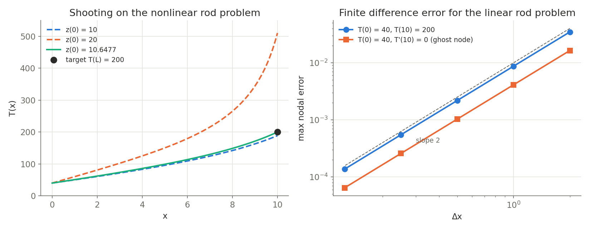

# Chapter 24 — Boundary-Value Problems

[Repository Guide](../../README.md) | [English](Concepts_Lecture.md) | [한국어](Concepts_Lecture.ko.md)

> **Last Updated:** 2026-11-19
>
> Applied Numerical Methods with Python for Engineers and Scientists, Chapra and Clough, Ch 24

> **Learning Objectives:**
> 1. Formulate boundary value problems for ODEs
> 2. Obtain the analytical solution of a linear BVP as the sum of the homogeneous and particular solutions
> 3. Apply the shooting method and the finite difference method
> 4. Analyze the accuracy and convergence of BVP solvers
> 5. Solve nonlinear BVPs by the shooting method combined with the secant method, and handle derivative boundary conditions with a ghost node
> 6. Solve BVPs with SciPy's solve_bvp, and apply finite differences with Newton's method to nonlinear BVPs

---

<br>

## Table of Contents

- [1. Introduction to Boundary-Value Problems (BVP)](#1-introduction-to-boundary-value-problems-bvp)
  - [1.1 Motivating Example: Heated Rod](#11-motivating-example-heated-rod)
  - [1.2 Governing Equation](#12-governing-equation)
  - [1.3 BVP vs. IVP](#13-bvp-vs-ivp)
- [2. Analytical Solution](#2-analytical-solution)
  - [2.1 Rearranging the Governing Equation](#21-rearranging-the-governing-equation)
  - [2.2 Homogeneous Solution](#22-homogeneous-solution)
  - [2.3 Particular Solution](#23-particular-solution)
  - [2.4 Total (General) Solution](#24-total-general-solution)
  - [2.5 Determining the Constants from Boundary Conditions](#25-determining-the-constants-from-boundary-conditions)
- [3. The Shooting Method (Section 24.2)](#3-the-shooting-method-section-242)
  - [3.1 Core Idea: Convert BVP into IVP](#31-core-idea-convert-bvp-into-ivp)
  - [3.2 Converting a 2nd-Order ODE to Two 1st-Order ODEs](#32-converting-a-2nd-order-ode-to-two-1st-order-odes)
  - [3.3 The Guessing Procedure](#33-the-guessing-procedure)
  - [3.4 Algorithm Summary](#34-algorithm-summary)
  - [3.5 Python Implementation](#35-python-implementation)
  - [3.6 Shooting for Nonlinear Problems](#36-shooting-for-nonlinear-problems)
  - [3.7 Shooting with Derivative Boundary Conditions](#37-shooting-with-derivative-boundary-conditions)
- [4. Finite Difference Methods (Section 24.3)](#4-finite-difference-methods-section-243)
  - [4.1 Core Idea: Discretize the Domain](#41-core-idea-discretize-the-domain)
  - [4.2 Second Derivative Approximation](#42-second-derivative-approximation)
  - [4.3 Generating the Finite Difference Equations](#43-generating-the-finite-difference-equations)
  - [4.4 Counting Unknowns and Equations](#44-counting-unknowns-and-equations)
  - [4.5 Assembling the Tridiagonal System](#45-assembling-the-tridiagonal-system)
  - [4.6 Matrix Formulation](#46-matrix-formulation)
  - [4.7 Python Implementation](#47-python-implementation)
  - [4.8 Derivative Boundary Conditions and Ghost Nodes](#48-derivative-boundary-conditions-and-ghost-nodes)
  - [4.9 Grid Refinement and the Order of Convergence](#49-grid-refinement-and-the-order-of-convergence)
  - [4.10 SciPy's solve_bvp](#410-scipys-solve_bvp)
  - [4.11 Finite Differences for Nonlinear BVPs with Newton's Method](#411-finite-differences-for-nonlinear-bvps-with-newtons-method)
  - [4.12 Accuracy and Cost of Shooting and Finite Differences](#412-accuracy-and-cost-of-shooting-and-finite-differences)
- [Concept Applications](#concept-applications)
- [Summary](#summary)
- [Self-Check Questions](#self-check-questions)
- [References](#references)

---

<br>

## 1. Introduction to Boundary-Value Problems (BVP)

### 1.1 Motivating Example: Heated Rod

Consider a **steady-state temperature distribution** for a long, thin rod positioned between two constant-temperature walls:

- The left wall is held at temperature $`T_a`$.
- The right wall is held at temperature $`T_b`$.
- The surrounding air temperature is $`T_\infty`$.
- The rod has length $`L`$.

```text
                 Ambient air T∞
 ┃   ↕    ↕    ↕    ↕    ↕    ↕    ↕    ↕   ┃   ↕ Convection
 ┃██████████████████████████████████████████┃   ◀─▶ Conduction (along the rod)
T_a                                        T_b
 ├──────────────────────────────────────────┤──▶ x
 0                                          L
```

*Figure 1. Conduction and convection in a heated rod between two walls*

Two mechanisms of heat transfer act on the rod:

| Mechanism | Direction | Description |
|:----------|:----------|:------------|
| **Conduction** | Along the rod (horizontal) | Heat flows through the rod material from one end to the other |
| **Convection** | Perpendicular to the rod (vertical) | Heat is exchanged between the rod surface and the surrounding air at $`T_\infty`$ |

*Table 1. Two heat transfer mechanisms acting on the heated rod*

The fundamental question is: **What is the temperature distribution $`T(x)`$ along the rod?**

The temperature $`T(x)`$ varies from $`T_a`$ at $`x = 0`$ to $`T_b`$ at $`x = L`$, and the profile between these endpoints depends on the balance of conduction and convection.

> **Note:** **Physics background.** Conduction is governed by Fourier's law and depends on the thermal conductivity of the rod material. Convection depends on the heat transfer coefficient between the rod surface and the surrounding fluid. The parameter $`h'`$ in the governing equation captures the relative strength of convective and conductive effects.

### 1.2 Governing Equation

The governing equation that combines heat conduction along the rod and convection to the surrounding air is:

```math
0 = \frac{d^2 T}{dx^2} + h'(T_\infty - T) \quad \cdots (**)
```

with **boundary conditions**:

```math
T(x = 0) = T_a, \quad T(x = L) = T_b
```

Here $`h'`$ is a parameter related to the convective heat transfer coefficient, the rod geometry, and the thermal conductivity.

Given two boundary values at the endpoints of the domain, we can solve for the temperature distribution $`T(x)`$.

### 1.3 BVP vs. IVP

| Feature | Initial-Value Problem (IVP) | Boundary-Value Problem (BVP) |
|:--------|:---------------------------|:-----------------------------|
| **Conditions given at** | A single point ($`x = x_0`$) | Two or more distinct points |
| **Typical conditions** | $`y(x_0) = y_0`$, $`y'(x_0) = y'_0`$ | $`y(a) = \alpha`$, $`y(b) = \beta`$ |
| **Solution approach** | March forward from $`x_0`$ | Cannot simply march from one end; needs iterative guessing (shooting) or a global solve (finite differences) |
| **Order** | Needs $`n`$ conditions at one point for $`n`$-th order ODE | Conditions split across boundary |

*Table 2. Comparison of initial-value and boundary-value problems*

> **Definition:** A **boundary value problem** is a problem in which the conditions on the solution of a differential equation are given at different points of the interval, usually at both end points. For the same equation, depending on the boundary conditions, the solution may be unique, may not exist, or may be infinitely many (Section 4.9).

> **[Calculus]** A second-order ODE generally requires two conditions to determine a unique solution. In an IVP, both conditions are specified at the same point (e.g., position and velocity at $`t = 0`$). In a BVP, the conditions are specified at different spatial locations (e.g., temperatures at both ends of a rod). A linear IVP with continuous coefficients has exactly one solution, but a BVP may have no solution or infinitely many even with two conditions. For example, $`y'' + y = 0`$, $`y(0) = 0`$, $`y(\pi) = 0`$ has the solution $`y = C \sin x`$ for every constant $`C`$.

---

<br>

## 2. Analytical Solution

### 2.1 Rearranging the Governing Equation

Express equation $`(**)`$ as:

```math
\frac{d^2 T}{dx^2} - h' T = -h' T_\infty
```

This is a **second-order linear ODE with constant coefficients** and a non-homogeneous term $`-h' T_\infty`$ on the right-hand side.

The total solution is the sum of:
1. The **homogeneous** solution
2. A **particular** solution

### 2.2 Homogeneous Solution

First, solve the homogeneous equation:

```math
\frac{d^2 T}{dx^2} - h' T = 0 \quad \cdots (***)
```

Assume a trial solution of the form $`T = C e^{\lambda x}`$.

Substituting into $`(***)`$:

```math
\lambda^2 C e^{\lambda x} - h' C e^{\lambda x} = (\lambda^2 - h') C e^{\lambda x} = 0
```

Since we seek a non-trivial solution ($`C \neq 0`$) and $`e^{\lambda x}`$ is never zero, the characteristic equation must be satisfied:

```math
\lambda^2 - h' = 0
```

```math
\lambda = \pm \sqrt{h'}
```

Thus the **homogeneous solution** is:

```math
T_h = C_1 e^{\lambda x} + C_2 e^{-\lambda x}, \quad \lambda = \sqrt{h'}
```

> **[Calculus]** The characteristic equation $`\lambda^2 - h' = 0`$ has two distinct real roots when $`h' > 0`$ (which is always the case for physical heat transfer). This gives two linearly independent solutions $`e^{\lambda x}`$ and $`e^{-\lambda x}`$, and their linear combination forms the complete homogeneous solution.

### 2.3 Particular Solution

A particular solution is any one solution that satisfies the full non-homogeneous equation. Since the right-hand side is constant, a constant function is a natural trial, and if $`T = T_\infty`$:

```math
\frac{d^2 T_\infty}{dx^2} - h' T_\infty = 0 - h' T_\infty = -h' T_\infty \quad \checkmark
```

Therefore the particular solution is:

```math
T_p = T_\infty
```

### 2.4 Total (General) Solution

The total solution is the sum of the homogeneous and particular solutions:

```math
T(x) = T_\infty + C_1 e^{\lambda x} + C_2 e^{-\lambda x}, \quad \lambda = \sqrt{h'}
```

### 2.5 Determining the Constants from Boundary Conditions

To determine $`C_1`$ and $`C_2`$, apply the two boundary conditions:

**At $`x = 0`$:**

```math
T_a = T(0) = T_\infty + C_1 + C_2
```

**At $`x = L`$:**

```math
T_b = T(L) = T_\infty + C_1 e^{\lambda L} + C_2 e^{-\lambda L}
```

This is a system of two equations in two unknowns ($`C_1`$, $`C_2`$).

**Solving for $`C_2`$:** Multiply the first equation by $`e^{\lambda L}`$ and subtract the second:

```math
e^{\lambda L} T_a - T_b = T_\infty (e^{\lambda L} - 1) + C_2 (e^{\lambda L} - e^{-\lambda L})
```

```math
\therefore \; C_2 = \frac{e^{\lambda L}(T_a - T_\infty) + (T_\infty - T_b)}{e^{\lambda L} - e^{-\lambda L}}
```

**Solving for $`C_1`$:** Multiply the first equation by $`e^{-\lambda L}`$ and subtract the second:

```math
e^{-\lambda L} T_a - T_b = e^{-\lambda L} T_\infty - T_\infty + C_1 (e^{-\lambda L} - e^{\lambda L})
```

```math
\therefore \; C_1 = \frac{e^{-\lambda L}(T_a - T_\infty) + (T_\infty - T_b)}{e^{-\lambda L} - e^{\lambda L}}
```

> **[Calculus]** The denominator $`e^{\lambda L} - e^{-\lambda L} = 2\sinh(\lambda L)`$ is always non-zero for $`\lambda > 0`$ and $`L > 0`$, guaranteeing a unique solution to the BVP. This confirms the physical expectation that the temperature distribution is uniquely determined by the boundary temperatures.

---

<br>

## 3. The Shooting Method (Section 24.2)

### 3.1 Core Idea: Convert BVP into IVP

The shooting method transforms a boundary-value problem into an initial-value problem by:

1. **Using** the known boundary condition at one end as the initial condition.
2. **Guessing** the missing initial condition (the derivative at that end).
3. **Integrating** the ODE from one boundary to the other using any IVP solver (e.g., Euler, RK4).
4. **Comparing** the computed result at the far boundary with the known boundary value.
5. **Adjusting** the guess and repeating until the far boundary condition is satisfied.

The name "shooting method" comes from the analogy of firing a projectile: you adjust the launch angle (the initial slope guess) until the projectile hits the target (the far boundary condition).

> **Definition:** The **shooting method** treats the missing initial condition at one end of a boundary value problem as a parameter, solves the initial value problem repeatedly, and determines that parameter by root finding so that the boundary condition at the other end is satisfied.

### 3.2 Converting a 2nd-Order ODE to Two 1st-Order ODEs

Starting from the governing equation:

```math
0 = \frac{d^2 T}{dx^2} + h'(T_\infty - T)
```

Introduce a new variable $`z`$:

```math
z := \frac{dT}{dx}
```

Then the single second-order ODE becomes a **system of two first-order ODEs**:

```math
\begin{cases} \dfrac{dT}{dx} = z \\[10pt] \dfrac{dz}{dx} = h'(T - T_\infty) \end{cases}
```

> **[Calculus]** This is a general technique: any $`n`$-th order ODE can be converted into a system of $`n`$ first-order ODEs by introducing auxiliary variables for each derivative up to order $`n-1`$. This is essential because most numerical ODE solvers (Euler, Runge-Kutta, etc.) are designed for first-order systems.

### 3.3 The Guessing Procedure

If we know both $`z(x = 0)`$ and $`T(x = 0)`$, we can integrate the system of ODEs from $`x = 0`$ to $`x = L`$.

However, in a BVP:
- $`T(x = 0) = T_a`$ is **known** (boundary condition).
- $`z(x = 0) = \frac{dT}{dx}\big|_{x=0}`$ is **unknown**.

**Procedure:**

1. **Guess** the initial slope as $`z(x = 0) = z_{a,1}`$ (first guess).
2. **Integrate** the pair of first-order ODEs from $`x = 0`$ to $`x = L`$ using a numerical method (e.g., RK4).
3. Obtain the computed temperature at the right boundary, $`T(x = L) = T_{b,1}`$.
4. **Compare** $`T_{b,1}`$ with the known $`T_b`$.
5. In general, $`T_{b,1} \neq T_b`$.
6. **Adjust** the guess to $`z(x = 0) = z_{a,2}`$ (new guess).
7. **Repeat** the integration and comparison until $`T(L) \approx T_b`$ within a desired tolerance.

The adjustment of the guess can be done systematically using root-finding methods:

- **Bisection method**: Bracket the correct slope between two guesses and keep narrowing the bracket.
- **Secant method / linear interpolation**: Use two guesses and their results to interpolate the next guess.

```math
z_{a,\text{new}} = z_{a,1} + \frac{(T_b - T_{b,1})(z_{a,2} - z_{a,1})}{T_{b,2} - T_{b,1}}
```

> **Note:** When the ODE is linear, as in this example, $`T(L)`$ is a linear function of $`z(0)`$. The $`z_{a,\text{new}}`$ obtained by linear interpolation of two trial shots is therefore the exact initial slope apart from the numerical error of the integration, and it satisfies the boundary condition without further iteration. With the example values of Section 4.7, the implementation in Section 3.5 converges at the first interpolation. For a nonlinear ODE this relation does not hold, so the interpolation must be repeated.

### 3.4 Algorithm Summary

```text
1. Set T(0) = Ta  (known boundary condition)
2. Guess z(0) = z_a1
3. Integrate the system of ODEs from x = 0 to x = L
4. Compute T(L) = T_b1
5. If |T_b1 - Tb| < tolerance: DONE
6. Else: adjust z(0) using root-finding, go to step 3
```

### 3.5 Python Implementation

```python
import numpy as np

def shooting_method(h_prime, T_inf, Ta, Tb, L, n_steps=100, tol=1e-6, max_iter=50):
    """
    Solve the BVP: d^2T/dx^2 + h'(T_inf - T) = 0
    with T(0) = Ta, T(L) = Tb using the shooting method.

    Parameters
    ----------
    h_prime : float  - heat transfer parameter
    T_inf   : float  - ambient temperature
    Ta      : float  - temperature at x = 0
    Tb      : float  - temperature at x = L
    L       : float  - length of the rod
    n_steps : int    - number of integration steps
    tol     : float  - convergence tolerance
    max_iter: int    - maximum number of shooting iterations
    """
    dx = L / n_steps

    def integrate(z0):
        """Integrate the system using RK4 from x=0 to x=L."""
        T = Ta
        z = z0
        T_vals = [T]
        x_vals = [0.0]

        for i in range(n_steps):
            x = i * dx

            # RK4 for the system dT/dx = z, dz/dx = h'(T - T_inf)
            k1_T = z
            k1_z = h_prime * (T - T_inf)

            k2_T = z + 0.5 * dx * k1_z
            k2_z = h_prime * ((T + 0.5 * dx * k1_T) - T_inf)

            k3_T = z + 0.5 * dx * k2_z
            k3_z = h_prime * ((T + 0.5 * dx * k2_T) - T_inf)

            k4_T = z + dx * k3_z
            k4_z = h_prime * ((T + dx * k3_T) - T_inf)

            T = T + (dx / 6) * (k1_T + 2*k2_T + 2*k3_T + k4_T)
            z = z + (dx / 6) * (k1_z + 2*k2_z + 2*k3_z + k4_z)

            T_vals.append(T)
            x_vals.append((i + 1) * dx)

        return np.array(x_vals), np.array(T_vals), T  # T at x = L

    # Two initial guesses for z(0)
    z1 = 0.0
    _, _, Tb1 = integrate(z1)

    z2 = 1.0
    _, _, Tb2 = integrate(z2)

    # Secant method to find the correct z(0)
    for iteration in range(max_iter):
        if abs(Tb2 - Tb1) < 1e-15:
            break

        # Linear interpolation for next guess
        z_new = z1 + (Tb - Tb1) * (z2 - z1) / (Tb2 - Tb1)
        x_vals, T_vals, Tb_new = integrate(z_new)

        if abs(Tb_new - Tb) < tol:
            print(f"Converged in {iteration + 1} iterations, z(0) = {z_new:.6f}")
            return x_vals, T_vals

        # Update for next iteration
        z1, Tb1 = z2, Tb2
        z2, Tb2 = z_new, Tb_new

    print(f"Warning: did not converge after {max_iter} iterations")
    return x_vals, T_vals
```

### 3.6 Shooting for Nonlinear Problems

As noted in Section 3.3, for a linear problem linear interpolation of two trials gives the answer at once, but for a nonlinear problem $`T(L)`$ is not a linear function of $`z(0)`$, so iteration is needed. If the rod surface loses heat by radiation in addition to convection, the governing equation contains a fourth-power term from the Stefan-Boltzmann law.

```math
0 = \frac{d^2 T}{dx^2} + h'(T_\infty - T) + \sigma'(T_\infty^4 - T^4)
```

Let $`h' = 0.01`$, $`\sigma' = 5 \times 10^{-9}`$, $`T_\infty = 20`$, $`L = 10`$, $`T(0) = 40`$, and $`T(10) = 200`$. The radiation term requires absolute temperature, so all temperatures in this example are taken as absolute temperatures, with $`\sigma'`$ a model parameter chosen accordingly. The shooting method turns this problem into root finding for the residual function $`r(z_a) = T(L; z_a) - T_b`$, where $`T(L; z_a)`$ is the temperature at the right end obtained by integrating the IVP with initial slope $`z_a`$. The secant method of Chapter 6, $`z_{k+1} = z_k - r_k\frac{z_k - z_{k-1}}{r_k - r_{k-1}}`$, is applied to this residual. The linear interpolation formula of Section 3.3 is one step of this secant method.

```python
import numpy as np
from scipy.integrate import solve_ivp

hp, sig, Tinf = 0.01, 5e-9, 20.0               # convection and radiation
L, Ta, Tb = 10.0, 40.0, 200.0

def rhs(x, w):
    T, z = w                                     # z = dT/dx
    return [z, -hp * (Tinf - T) - sig * (Tinf**4 - T**4)]

def residual(za):
    sol = solve_ivp(rhs, (0.0, L), [Ta, za], rtol=1e-10, atol=1e-10)
    return sol.y[0, -1] - Tb                     # T(L) - Tb

z0, z1 = 10.0, 20.0                              # two initial guesses
r0, r1 = residual(z0), residual(z1)
print(f"  k     z(0)          T(L) - Tb")
print(f"  0  {z0:12.6f}  {r0:14.6f}")
print(f"  1  {z1:12.6f}  {r1:14.6f}")
for k in range(2, 9):                            # secant iteration on residual(z) = 0
    z2 = z1 - r1 * (z1 - z0) / (r1 - r0)
    r2 = residual(z2)
    print(f"  {k}  {z2:12.6f}  {r2:14.6f}")
    if abs(r2) < 1e-8:
        break
    z0, r0, z1, r1 = z1, r1, z2, r2
```

```text
  k     z(0)          T(L) - Tb
  0     10.000000      -11.264872
  1     20.000000      310.481159
  2     10.350117       -5.240232
  3     10.510282       -2.433675
  4     10.649168        0.026823
  5     10.647654       -0.000137
  6     10.647662       -0.000000
```

- `rhs` writes the second-order ODE as the first-order system $`T' = z`$, $`z' = -h'(T_\infty - T) - \sigma'(T_\infty^4 - T^4)`$, as in Section 3.2.
- `residual` integrates the IVP to the end with the given initial slope and returns the mismatch of the right boundary condition. The integration uses tight tolerances because, if integration error enters the residual, root finding cannot become more accurate than that error.
- The loop is the secant method and stops when the residual falls below $`10^{-8}`$.

The residuals of the first two trials, $`-11.3`$ and $`+310.5`$, differ greatly in size. As $`z(0)`$ grows, the temperature rises and the effect of the radiation term $`-\sigma'T^4`$ grows rapidly, so $`T(L)`$ increases nonlinearly. The first secant step therefore falls short of the exact value, after which the superlinear convergence of the secant method shrinks the error quickly from the third iteration on, giving $`z(0) = 10.647662`$ at the sixth iteration (left panel of Figure 3). Solving the same problem with convection only gives $`z(0) \approx 12.6905`$, so radiation removes additional heat and a smaller initial slope suffices for the same end temperature.

> **Caution:** The shooting method is hard to use when the IVP integration is unstable. For problems whose solution has an exponentially growing component (the $`e^{\lambda x}`$ component in this example), a long interval or a large $`\lambda`$ amplifies small differences in the initial slope enormously at $`T(L)`$, so the residual overflows or the root finding fails to converge. In such cases, multiple shooting over subintervals or the finite difference method of Section 4 is used.

### 3.7 Shooting with Derivative Boundary Conditions

The framework of the shooting method is the same when a boundary condition gives a derivative instead of a value; only which initial condition is unknown changes. If, as in Section 4.8, the left end is insulated so that $`T'(0) = 0`$ and the right end has $`T(10) = 200`$, the slope at $`x = 0`$ is known and the temperature $`T(0)`$ is not. Therefore $`T(0)`$ is guessed, the IVP is integrated from $`(T(0), T'(0)) = (\text{guess}, 0)`$, and $`T(10)`$ is compared with the target 200.

```python
import numpy as np
from scipy.integrate import solve_ivp

hp, Tinf, L, Tb = 0.01, 20.0, 10.0, 200.0          # T'(0) = 0 (insulated), T(L) = Tb

def T_at_L(Ta):                                    # unknown left value is the shooting parameter
    sol = solve_ivp(lambda x, w: [w[1], -hp * (Tinf - w[0])], (0.0, L), [Ta, 0.0],
                    rtol=1e-10, atol=1e-10)
    return sol.y[0, -1]

g1, g2 = 100.0, 150.0
r1, r2 = T_at_L(g1), T_at_L(g2)
Ta = g1 + (Tb - r1) * (g2 - g1) / (r2 - r1)        # linear interpolation (Section 3.3)
print(f"T(0) = {g1}: T(L) = {r1:.6f}")
print(f"T(0) = {g2}: T(L) = {r2:.6f}")
print(f"interpolated T(0) = {Ta:.6f}, check T(L) = {T_at_L(Ta):.6f}")
lam = np.sqrt(hp)
print(f"exact T(0) = {Tinf + (Tb - Tinf) / np.cosh(lam * L):.6f}")
```

```text
T(0) = 100.0: T(L) = 143.446451
T(0) = 150.0: T(L) = 220.600483
interpolated T(0) = 136.649769, check T(L) = 200.000000
exact T(0) = 136.649769
```

- In the initial condition `[Ta, 0.0]` of `T_at_L`, the second component 0 is the insulation condition $`T'(0) = 0`$ and the first component is the shooting parameter.
- The problem is linear, so as in Section 3.3, linear interpolation of two trials immediately gives $`T(0) = 136.6498`$, which satisfies the boundary condition.
- For the analytical solution, $`T'(0) = 0`$ gives $`C_1 = C_2`$, so $`T = T_\infty + (T_b - T_\infty)\frac{\cosh\lambda x}{\cosh\lambda L}`$ and $`T(0) = 20 + \frac{180}{\cosh 1} = 136.6498`$, the same as the numerical result.

If both ends have derivative conditions (for example, $`T'(0) = q_0`$ and $`T'(L) = q_L`$), the temperature at one end is taken as the parameter and the slope at the other end is matched. In this case, however, the solution may not be unique, so care is needed. For example, if $`h' = 0`$ and both ends are insulated, adding any constant to a solution gives another solution.

---

<br>

## 4. Finite Difference Methods (Section 24.3)

### 4.1 Core Idea: Discretize the Domain

Instead of converting the BVP into an IVP, the finite difference (FD) method **directly discretizes** the governing equation at a set of grid points, producing a system of algebraic equations that can be solved simultaneously.

> **Definition:** The **finite difference method** replaces the derivatives of a differential equation with difference approximations at grid points, forms a system of algebraic equations for the unknown values at all grid points, and solves it all at once.

Starting from:

```math
\frac{d^2 T}{dx^2} - h' T = -h' T_\infty
```

Note that the right-hand side $`-h' T_\infty`$ is a **known value**.

### 4.2 Second Derivative Approximation

Divide the domain $`[0, L]`$ into $`n`$ equal subintervals with spacing $`\Delta x = L / n`$, creating nodes $`x_0, x_1, \ldots, x_n`$.

```text
T_0 = T_a                                         T_n = T_b
  ●───────○───────○── ... ──○───────○───────○── ... ──●
 x_0     x_1     x_2     x_{i-1}   x_i   x_{i+1}     x_n
  ├── Δx ─┤
 ● Boundary node (known value)   ○ Interior node (unknown)
```

*Figure 2. Boundary and interior nodes of the finite difference grid*

The **central difference approximation** for the second derivative at node $`x_i`$ is:

```math
\left. \frac{d^2 T}{dx^2} \right|_{x_i} \approx \frac{T_{i-1} - 2T_i + T_{i+1}}{(\Delta x)^2}
```

> **Note:** This approximation is the central difference formula for the second derivative derived in Section 10.4 of Chapter 4 and Section 3.1 of Chapter 21, obtained by adding the forward and backward Taylor expansions around $`x_i`$. The leading error term is $`O((\Delta x)^2)`$, meaning the approximation has second-order accuracy.

### 4.3 Generating the Finite Difference Equations

Substituting the central difference approximation into the governing equation at node $`x_i`$:

```math
\frac{T_{i-1} - 2T_i + T_{i+1}}{(\Delta x)^2} - h' T_i = -h' T_\infty
```

This equation holds for each **interior** node $`i = 1, 2, \ldots, n-1`$.

Combined with the boundary conditions:
- $`T_0 = T_a`$ (left boundary)
- $`T_n = T_b`$ (right boundary)

This gives a total of $`(n+1)`$ equations for $`(n+1)`$ unknowns $`T_0, T_1, \ldots, T_n`$.

### 4.4 Counting Unknowns and Equations

| Item | Count |
|:-----|:------|
| Total unknowns: $`T_0, T_1, \ldots, T_n`$ | $`n + 1`$ |
| Boundary conditions: $`T_0 = T_a`$, $`T_n = T_b`$ | $`2`$ |
| Interior FD equations (at $`x_1, x_2, \ldots, x_{n-1}`$) | $`n - 1`$ |
| **Total equations** | $`n + 1`$ |

*Table 3. Number of unknowns and equations*

Since $`T_0`$ and $`T_n`$ are known from the boundary conditions, the system reduces to $`(n - 1)`$ equations in $`(n - 1)`$ unknowns $`T_1, T_2, \ldots, T_{n-1}`$.

### 4.5 Assembling the Tridiagonal System

Define the following constants for convenience:

```math
G = 2 + (\Delta x)^2 h', \quad F = h' T_\infty (\Delta x)^2
```

Multiply the FD equation at each node by $`(\Delta x)^2`$ and rearrange:

**i) First interior node ($`i = 1`$):**

```math
T_0 - 2T_1 + T_2 - (\Delta x)^2 h' T_1 = -h' T_\infty (\Delta x)^2
```

Since $`T_0`$ is known, move it to the right-hand side:

```math
(-2 - (\Delta x)^2 h') T_1 + T_2 = -h' T_\infty (\Delta x)^2 - T_0
```

```math
-G \cdot T_1 + T_2 = -F - T_0
```

**ii) General interior nodes ($`i = 2, 3, \ldots, n-2`$):**

```math
T_{i-1} - 2T_i + T_{i+1} - (\Delta x)^2 h' T_i = -h' T_\infty (\Delta x)^2
```

```math
T_{i-1} - (2 + (\Delta x)^2 h') T_i + T_{i+1} = -h' T_\infty (\Delta x)^2
```

```math
T_{i-1} - G \cdot T_i + T_{i+1} = -F
```

**iii) Last interior node ($`i = n-1`$):**

```math
T_{n-2} - 2T_{n-1} + T_n - (\Delta x)^2 h' T_{n-1} = -h' T_\infty (\Delta x)^2
```

Since $`T_n`$ is known, move it to the right-hand side:

```math
T_{n-2} - (2 + (\Delta x)^2 h') T_{n-1} = -h' T_\infty (\Delta x)^2 - T_n
```

```math
T_{n-2} - G \cdot T_{n-1} = -F - T_n
```

If $`n = 2`$, there is only one interior node $`T_1`$, so i) and iii) become the same equation, $`-G \cdot T_1 = -F - T_0 - T_2`$. The general interior equation ii) appears only when $`n \geq 4`$.

### 4.6 Matrix Formulation

Combining all the interior equations into matrix form:

```math
\begin{bmatrix} -G & 1 & & & \\ 1 & -G & 1 & & \\ & 1 & -G & 1 & \\ & & \ddots & \ddots & \ddots \\ & & & 1 & -G \end{bmatrix} \begin{bmatrix} T_1 \\ T_2 \\ T_3 \\ \vdots \\ T_{n-1} \end{bmatrix} = \begin{bmatrix} -F \\ -F \\ -F \\ \vdots \\ -F \end{bmatrix} - \begin{bmatrix} T_0 \\ 0 \\ 0 \\ \vdots \\ T_n \end{bmatrix}
```

This is a **tridiagonal system** of $`(n-1)`$ equations that can be solved using:
- **Thomas algorithm** (tridiagonal matrix algorithm), which solves it efficiently in $`O(n)`$ time.
- **NumPy's `linalg.solve`** or any standard linear algebra solver, which is simple to use but treats the matrix as dense and takes $`O(n^3)`$ time.

> **Note:** The coefficient matrix is tridiagonal, symmetric, and strictly diagonally dominant. For $`h' > 0`$, the magnitude of each diagonal entry, $`G = 2 + (\Delta x)^2 h'`$, exceeds 2, while each row has at most two off-diagonal entries, each equal to 1. A strictly diagonally dominant matrix is nonsingular, so the system has a unique solution, and by the convergence condition of Section 3 of Chapter 12, iterative methods like Gauss-Seidel converge.

### 4.7 Python Implementation

```python
import numpy as np

def finite_difference_bvp(h_prime, T_inf, Ta, Tb, L, n=10):
    """
    Solve the BVP: d^2T/dx^2 + h'(T_inf - T) = 0
    with T(0) = Ta, T(L) = Tb using finite differences.

    Parameters
    ----------
    h_prime : float  - heat transfer parameter
    T_inf   : float  - ambient temperature
    Ta      : float  - temperature at x = 0 (T_0)
    Tb      : float  - temperature at x = L (T_n)
    L       : float  - length of the rod
    n       : int    - number of subintervals
    """
    dx = L / n
    G = 2 + dx**2 * h_prime       # diagonal coefficient
    F = h_prime * T_inf * dx**2   # forcing term

    # Build the (n-1) x (n-1) tridiagonal coefficient matrix
    size = n - 1
    A = np.zeros((size, size))
    b = np.full(size, -F)

    for i in range(size):
        A[i, i] = -G                          # main diagonal
        if i > 0:
            A[i, i - 1] = 1.0                 # lower diagonal
        if i < size - 1:
            A[i, i + 1] = 1.0                 # upper diagonal

    # Adjust RHS for boundary conditions
    b[0] -= Ta        # T_0 = Ta is known
    b[-1] -= Tb       # T_n = Tb is known

    # Solve the tridiagonal system
    T_interior = np.linalg.solve(A, b)

    # Assemble full solution including boundary nodes
    T_full = np.concatenate(([Ta], T_interior, [Tb]))
    x_full = np.linspace(0, L, n + 1)

    return x_full, T_full
```

**Example usage:** comparing both methods with the analytical solution.

```python
import matplotlib.pyplot as plt

# Problem parameters
h_prime = 0.01    # heat transfer parameter
T_inf = 20.0      # ambient temperature
Ta = 40.0         # left boundary temperature
Tb = 200.0        # right boundary temperature
L = 10.0          # rod length

# Analytical solution
lam = np.sqrt(h_prime)
C1 = (np.exp(-lam*L) * (Ta - T_inf) + (T_inf - Tb)) / (np.exp(-lam*L) - np.exp(lam*L))
C2 = (np.exp(lam*L) * (Ta - T_inf) + (T_inf - Tb)) / (np.exp(lam*L) - np.exp(-lam*L))

x_exact = np.linspace(0, L, 200)
T_exact = T_inf + C1 * np.exp(lam * x_exact) + C2 * np.exp(-lam * x_exact)

# Shooting method
x_shoot, T_shoot = shooting_method(h_prime, T_inf, Ta, Tb, L, n_steps=100)

# Finite difference method
x_fd, T_fd = finite_difference_bvp(h_prime, T_inf, Ta, Tb, L, n=10)

# Plot comparison
plt.figure(figsize=(10, 6))
plt.plot(x_exact, T_exact, 'k-', label='Analytical', linewidth=2)
plt.plot(x_shoot, T_shoot, 'b--o', label='Shooting method', markersize=4)
plt.plot(x_fd, T_fd, 'r--s', label='Finite difference', markersize=6)
plt.xlabel('x')
plt.ylabel('T(x)')
plt.title('BVP Solution: Heated Rod')
plt.legend()
plt.grid(True)
plt.show()
```

Running this example gives the analytical constants $`C_1 \approx 73.4523`$ and $`C_2 \approx -53.4523`$. The shooting method converges at the first interpolation with $`z(0) \approx 12.6905`$, and the finite difference solution with $`n = 10`$ gives $`108.6904`$ at $`x = 5`$ (analytical $`108.6819`$), with an error below $`0.009`$ at every node.

### 4.8 Derivative Boundary Conditions and Ghost Nodes

The boundary conditions so far have been Dirichlet conditions, which give the value at an end point. A condition that gives the derivative at an end point is called a Neumann condition; for example, if the right end of the rod is insulated, the heat flux is zero, so $`T'(L) = 0`$. Then $`T_n = T(L)`$ becomes an unknown, and there are $`n`$ unknowns $`T_1, \ldots, T_n`$.

Using the difference equation of Section 4.3, $`T_{n-1} - GT_n + T_{n+1} = -h'(\Delta x)^2 T_\infty`$, at $`x_n`$ as well requires a **ghost node** $`T_{n+1}`$ outside the domain. Approximating the boundary condition by a second-order central difference gives

```math
T'(L) \approx \frac{T_{n+1} - T_{n-1}}{2\Delta x} \quad \Longrightarrow \quad T_{n+1} = T_{n-1} + 2\Delta x\,T'(L)
```

and substituting it gives the last equation below.

```math
2T_{n-1} - GT_n = -h'(\Delta x)^2 T_\infty - 2\Delta x\,T'(L)
```

Apart from the coefficient of $`T_{n-1}`$ in the last row changing from 1 to 2, the tridiagonal structure is unchanged. The one-sided difference $`T'(L) \approx (T_n - T_{n-1})/\Delta x`$ is simpler but only first-order accurate, and it spoils the second-order accuracy of the interior.

For $`T(0) = 40`$, $`T'(10) = 0`$, $`h' = 0.01`$, and $`T_\infty = 20`$, applying $`C_1 + C_2 = 20`$ and $`\lambda(C_1e^{\lambda L} - C_2e^{-\lambda L}) = 0`$ to the general solution $`T = T_\infty + C_1e^{\lambda x} + C_2e^{-\lambda x}`$ of Section 2 gives the analytical solution with $`C_1 = 20/(1 + e^{2\lambda L})`$ and $`C_2 = 20 - C_1`$. The code below builds the system multiplied by $`-1`$ (diagonal entries $`G`$, off-diagonal entries $`-1`$).

```python
import numpy as np

hp, Tinf, L, Ta = 0.01, 20.0, 10.0, 40.0          # T(0) = Ta, T'(L) = 0 (insulated)
lam = np.sqrt(hp)
C1 = (Ta - Tinf) / (1.0 + np.exp(2 * lam * L)); C2 = (Ta - Tinf) - C1
exact = lambda x: Tinf + C1 * np.exp(lam * x) + C2 * np.exp(-lam * x)

def fd_neumann(n):
    dx = L / n
    G = 2.0 + hp * dx**2
    A = np.zeros((n, n)); b = np.full(n, hp * dx**2 * Tinf)   # unknowns T_1 .. T_n
    for i in range(n):
        A[i, i] = G
        if i > 0: A[i, i - 1] = -1.0
        if i < n - 1: A[i, i + 1] = -1.0
    b[0] += Ta                                   # Dirichlet value at x = 0
    A[n - 1, n - 2] = -2.0                       # ghost node: T_{n+1} = T_{n-1}
    T = np.linalg.solve(A, b)
    return np.linspace(dx, L, n), T

print(f"exact T(10) = {exact(L):.6f}")
prev = None
for n in [5, 10, 20, 40]:
    x, T = fd_neumann(n)
    err = abs(T[-1] - exact(L))
    ratio = f"{prev / err:6.2f}" if prev else "      "
    print(f"n = {n:2d}, dx = {L / n:5.3f}: T(10) = {T[-1]:.6f}, error = {err:.2e}  ratio {ratio}")
    prev = err
```

```text
exact T(10) = 32.961085
n =  5, dx = 2.000: T(10) = 32.977467, error = 1.64e-02  ratio       
n = 10, dx = 1.000: T(10) = 32.965194, error = 4.11e-03  ratio   3.99
n = 20, dx = 0.500: T(10) = 32.962113, error = 1.03e-03  ratio   4.00
n = 40, dx = 0.250: T(10) = 32.961343, error = 2.57e-04  ratio   4.00
```

- `b[0] += Ta` is the left boundary value moved into the first equation. No value is given at the right, so there is no corresponding term.
- `A[n - 1, n - 2] = -2.0` is the result of eliminating the ghost node. Since $`T'(L) = 0`$, the term $`2\Delta x\,T'(L)`$ to be added to the right-hand side is zero.
- The temperature at the insulated end is about 32.96: heat escapes only to the air, so it falls toward the ambient temperature 20. The error ratio is 4, so the boundary treatment with a ghost node also preserves $`O(\Delta x^2)`$ accuracy.

Working by hand on the smallest grid makes the structure clear. With $`n = 2`$ ($`\Delta x = 5`$), $`G = 2 + 0.01 \times 25 = 2.25`$, the right-hand constant is $`h'(\Delta x)^2T_\infty = 5`$, and the unknowns are $`T_1 = T(5)`$ and $`T_2 = T(10)`$. The equation at node 1 is $`40 - 2.25T_1 + T_2 = -5`$, and at node 2, after eliminating the ghost node, $`2T_1 - 2.25T_2 = -5`$.

```math
\begin{pmatrix} 2.25 & -1 \\ -2 & 2.25 \end{pmatrix}\begin{pmatrix} T_1 \\ T_2 \end{pmatrix} = \begin{pmatrix} 45 \\ 5 \end{pmatrix} \quad \Longrightarrow \quad T_1 = 34.6939, \quad T_2 = 33.0612
```

Substituting $`T_2 = (2T_1 + 5)/2.25`$ from the second equation into the first gives $`3.0625T_1 = 106.25`$, so $`T_1 = 34.6939`$. Compared with the analytical values $`T(5) = 34.6153`$ and $`T(10) = 32.9611`$, the errors are 0.08 and 0.10 even with the very wide spacing of 5. The difference from the Dirichlet problem is that only the last row of the coefficient matrix, $`(-2, 2.25)`$, is not symmetric; dividing that equation by 2 to make the last row $`(-1, 1.125)`$ restores a symmetric matrix.


### 4.9 Grid Refinement and the Order of Convergence

Halving the grid spacing $`\Delta x`$ repeatedly for the Dirichlet problem of Section 4.7 and the Neumann problem of Section 4.8 and measuring the maximum error over all nodes shows the error dropping to about a quarter each time in both cases (right panel of Figure 3). The maximum errors of the Dirichlet problem at $`\Delta x = 2, 1, 0.5, 0.25, 0.125`$ are $`3.47 \times 10^{-2}`$, $`8.70 \times 10^{-3}`$, $`2.18 \times 10^{-3}`$, $`5.46 \times 10^{-4}`$, and $`1.37 \times 10^{-4}`$. The error is proportional to $`\Delta x^2`$ because the truncation error of the second-derivative approximation of Section 4.2 is $`O(\Delta x^2)`$.



*Figure 3. Shooting trajectories for the nonlinear rod problem and finite difference error for the linear rod problem*

Because the error is proportional to $`\Delta x^2`$, the Richardson extrapolation of Chapter 20 can also be used. With solutions $`T_{\Delta x}`$ and $`T_{\Delta x/2}`$ at the same node, $`\frac{4T_{\Delta x/2} - T_{\Delta x}}{3}`$ is $`O(\Delta x^4)`$ accurate. Using $`T(10)`$ for $`n = 20`$ and $`n = 40`$ from the table of Section 4.8 gives $`\frac{4(32.961343) - 32.962113}{3} = 32.961086`$, which agrees with the exact value 32.961085 almost to the sixth decimal place.

> **Note:** **Eigenvalue problems.** For $`y'' + p^2y = 0`$, $`y(0) = y(L) = 0`$, which describes the vibration of a string fixed at both ends or the buckling of a column, $`y = 0`$ is always a solution, and a nonzero solution of the general solution $`y = A\sin px + B\cos px`$ exists only when $`B = 0`$ and $`\sin pL = 0`$, that is, only when $`p = k\pi/L`$ ($`k = 1, 2, \ldots`$). These values are called eigenvalues, and the corresponding solutions $`\sin(k\pi x/L)`$ eigenfunctions. What is sought is the parameter $`p`$ for which a solution exists, so with the shooting method the target of root finding becomes $`p`$ rather than the slope.
>
> Applying finite differences gives $`\frac{-y_{i-1} + 2y_i - y_{i+1}}{(\Delta x)^2} = p^2 y_i`$ at the interior nodes, which is the matrix eigenvalue problem $`A\mathbf{y} = p^2\mathbf{y}`$ of Chapter 13 for the symmetric tridiagonal matrix $`A`$ with diagonal entries $`2/(\Delta x)^2`$ and off-diagonal entries $`-1/(\Delta x)^2`$. With $`L = 1`$ and $`n = 10`$ (9 interior nodes), the lowest four eigenvalues $`p^2`$ from `np.linalg.eigvalsh` are 9.7887, 38.1966, 82.4429, and 138.1966, with relative errors of 0.82%, 3.25%, 7.19%, and 12.49% against the exact values $`(k\pi)^2`$. The eigenfunctions of higher modes oscillate faster, so fewer nodes fall within one wavelength and the error is larger. The error is $`O(\Delta x^2)`$, so bringing the error of the lowest eigenvalue below 0.1% requires reducing $`\Delta x`$ by a factor of about $`\sqrt{0.1/0.82} \approx 0.35`$, to about $`n \approx 29`$.

### 4.10 SciPy's solve_bvp

SciPy's `scipy.integrate.solve_bvp` solves boundary value problems for systems of ODEs. It controls the residual on each mesh interval with a fourth-order collocation algorithm and solves the collocation equations by a damped Newton method. The default tolerance `tol` is $`10^{-3}`$, and the `sol` of the result is a $`C^1`$ continuous cubic spline representing the solution [1]. Solving the nonlinear problem of Section 3.6 gives the following.

```python
import numpy as np
from scipy.integrate import solve_bvp

hp, sig, Tinf, L, Ta, Tb = 0.01, 5e-9, 20.0, 10.0, 40.0, 200.0

def fun(x, w):                                   # w[0] = T, w[1] = dT/dx
    T, z = w
    return np.vstack([z, -hp * (Tinf - T) - sig * (Tinf**4 - T**4)])

def bc(wa, wb):                                  # residuals of the boundary conditions
    return np.array([wa[0] - Ta, wb[0] - Tb])

x = np.linspace(0.0, L, 11)
w0 = np.vstack([np.linspace(Ta, Tb, x.size), np.full(x.size, (Tb - Ta) / L)])
res = solve_bvp(fun, bc, x, w0, tol=1e-6)
print("status:", res.status, "| iterations:", res.niter, "| nodes:", res.x.size)
print(f"dT/dx(0) = {res.sol(0.0)[1]:.6f}")
print(f"T(5)     = {res.sol(5.0)[0]:.6f}")
print(f"max rms residual = {res.rms_residuals.max():.1e}")
```

```text
status: 0 | iterations: 5 | nodes: 94
dT/dx(0) = 10.647662
T(5)     = 99.029452
max rms residual = 1.0e-06
```

- `fun(x, w)` receives the values at all mesh points at once. `w` is an array of shape `(2, m)`, and the return value must have the same shape, so the two rows are stacked with `np.vstack` [1].
- `bc(wa, wb)` receives the state vectors at both ends and returns the residuals of the boundary conditions. The solver drives these residuals to zero, so $`T(0) - T_a`$ and $`T(L) - T_b`$ are used.
- The initial guess `w0` takes the temperature as the straight line between the two boundary values and the slope as the slope of that line. For nonlinear problems, the closer the initial guess is to the solution, the better the Newton iteration converges.
- `status` 0 means convergence to the requested accuracy [1]. The mesh was refined from the initial 11 nodes to 94 to reduce the residuals.

The initial slope 10.647662 from `solve_bvp` agrees with the shooting result of Section 3.6. The shooting method combines an IVP solver with root finding, whereas `solve_bvp`, like the finite difference method, treats the solution over the whole interval as unknowns at once, so it can be used even for problems where shooting is unstable.

### 4.11 Finite Differences for Nonlinear BVPs with Newton's Method

Applying finite differences to the nonlinear problem with the radiation term of Section 3.6 gives the following equation at each interior node $`i = 1, \ldots, n-1`$.

```math
F_i(\mathbf{T}) = T_{i-1} - 2T_i + T_{i+1} + (\Delta x)^2\left[h'(T_\infty - T_i) + \sigma'(T_\infty^4 - T_i^4)\right] = 0
```

Because of $`T_i^4`$ this system is nonlinear, so it is not finished with a single linear solve as in Section 4.6. The Newton-Raphson method of Chapter 6 is extended to systems of equations: $`J\,\Delta\mathbf{T} = -\mathbf{F}`$ is solved and $`\mathbf{T} \leftarrow \mathbf{T} + \Delta\mathbf{T}`$ repeated. $`F_i`$ depends only on $`T_{i-1}, T_i, T_{i+1}`$, so the Jacobian $`J = \partial\mathbf{F}/\partial\mathbf{T}`$ is also tridiagonal.

```math
\frac{\partial F_i}{\partial T_{i \pm 1}} = 1, \qquad \frac{\partial F_i}{\partial T_i} = -2 - (\Delta x)^2\left(h' + 4\sigma' T_i^3\right)
```

```python
import numpy as np

hp, sig, Tinf, L, Ta, Tb = 0.01, 5e-9, 20.0, 10.0, 40.0, 200.0

def fd_nonlinear(n, tol=1e-10, verbose=False):
    dx = L / n
    x = np.linspace(0.0, L, n + 1)
    T = Ta + (Tb - Ta) * x / L                    # initial guess: straight line
    for it in range(1, 30):
        Ti = T[1:-1]
        F = T[:-2] - 2 * Ti + T[2:] + dx**2 * (hp * (Tinf - Ti) + sig * (Tinf**4 - Ti**4))
        J = (np.diag(-2.0 - dx**2 * (hp + 4 * sig * Ti**3))
             + np.diag(np.ones(n - 2), 1) + np.diag(np.ones(n - 2), -1))
        dT = np.linalg.solve(J, -F)               # Newton step on the interior nodes
        T[1:-1] += dT
        if verbose:
            print(f"  iteration {it}: max |dT| = {np.max(np.abs(dT)):.3e}")
        if np.max(np.abs(dT)) < tol:
            return x, T

x, T = fd_nonlinear(10, verbose=True)
for n in [10, 20, 40]:
    x, T = fd_nonlinear(n)
    print(f"n = {n:2d}: T(5) = {T[n // 2]:.6f}")
```

```text
  iteration 1: max |dT| = 2.086e+01
  iteration 2: max |dT| = 1.353e+00
  iteration 3: max |dT| = 4.171e-03
  iteration 4: max |dT| = 3.808e-08
  iteration 5: max |dT| = 2.684e-14
n = 10: T(5) = 99.236347
n = 20: T(5) = 99.082177
n = 40: T(5) = 99.042700
```

- The initial guess is the straight line joining the two boundary values. The boundary nodes $`T_0 = 40`$ and $`T_n = 200`$ are fixed, and only the interior nodes are updated.
- `F` computes the residuals of all interior equations at once with array operations, and `J` is the tridiagonal matrix built from the partial derivatives above. `np.linalg.solve` is used here for simplicity, but the Thomas algorithm of Chapter 9 makes each iteration $`O(n)`$.
- The size of the update falls as $`20.9 \to 1.35 \to 4.2 \times 10^{-3} \to 3.8 \times 10^{-8}`$, roughly doubling the number of correct digits at each iteration: the quadratic convergence of Newton's method.

$`T(5)`$ changes as $`99.2363 \to 99.0822 \to 99.0427`$ as $`n`$ doubles, and its difference from the `solve_bvp` value 99.029452 of Section 4.10, $`0.207, 0.053, 0.013`$, falls to about a quarter each time, so the method is $`O(\Delta x^2)`$ for the nonlinear problem too. Applying the Richardson extrapolation of Section 4.9 to $`n = 20, 40`$ gives $`\frac{4(99.042700) - 99.082177}{3} = 99.029541`$, which agrees with `solve_bvp` to four decimal places. Nonlinear shooting was a scalar root-finding problem for one boundary condition, whereas the nonlinear finite difference method is Newton's method for a system of $`n - 1`$ unknowns; in return, there is no concern that the IVP integration becomes unstable, as in shooting.

### 4.12 Accuracy and Cost of Shooting and Finite Differences

The linear rod problem ($`T(0) = 40`$, $`T(10) = 200`$) is solved by both methods with the same grid spacing, and the maximum errors over all nodes are compared. The shooting method uses fixed-step RK4 for two trials and integrates once more with the interpolated slope to obtain the nodal values.

| $`n`$ | Shooting (RK4) max error | Shooting function evaluations | Finite difference max error | Finite difference unknowns |
|:-----|:-----|:-----|:-----|:-----|
| 5 | $`2.05 \times 10^{-4}`$ | 60 | $`3.47 \times 10^{-2}`$ | 4 |
| 10 | $`1.51 \times 10^{-5}`$ | 120 | $`8.70 \times 10^{-3}`$ | 9 |
| 20 | $`1.01 \times 10^{-6}`$ | 240 | $`2.18 \times 10^{-3}`$ | 19 |
| 40 | $`6.59 \times 10^{-8}`$ | 480 | $`5.46 \times 10^{-4}`$ | 39 |

*Table 4. Errors and costs of shooting (RK4) and finite differences for the linear rod problem*

At the same spacing, shooting with RK4 reduces the error as $`O(h^4)`$ and is far more accurate than the second-order finite difference method. In cost, shooting integrates the IVP three times and needs $`12n`$ right-hand-side evaluations, while the finite difference method solves one tridiagonal system with $`n - 1`$ unknowns. The criteria for choosing between them are as follows.

| Item | Shooting | Finite differences |
|:-----|:-----|:-----|
| Accuracy | Inherits the order of the IVP solver (fourth order with RK4; adaptive solvers can be used) | Order of the difference formula (usually second), raised by Richardson extrapolation or higher-order differences |
| Nonlinear problems | Scalar root finding for one boundary condition | Newton iteration on $`n - 1`$ unknowns (sparse Jacobian) |
| Stability | Integration becomes unstable if a component grows exponentially | No direction of integration, so no such instability |
| Extensibility | Suited to one-dimensional problems | Extends directly to partial differential equations in two and three dimensions |

*Table 5. Criteria for choosing between shooting and finite differences*

In problems where $`h'`$ is large or the interval long, so that the $`e^{\lambda x}`$ component grows greatly, the accuracy advantage of shooting is lost to roundoff and instability, and global methods such as finite differences or `solve_bvp` are safer.

---

<br>

## Concept Applications

**True/False Check:**

| Statement | Judgment and Reason |
|:-----|:-----|
| In shooting for a linear BVP, linear interpolation of two trials gives the exact initial slope apart from integration error. | **T.** For a linear problem, $`T(L)`$ is a linear function of the initial slope (Section 3.3). |
| Nonlinear BVPs can be solved only by shooting. | **F.** The finite difference method also finds the solution by solving the discretized nonlinear system with Newton's method (Section 4.11). |
| Shooting cannot be used when there is a derivative boundary condition. | **F.** The unknown initial condition simply becomes a value instead of a slope, and root finding proceeds in the same way (Section 3.7). |
| With a ghost node, the finite difference method handles derivative boundary conditions with second-order accuracy. | **T.** The boundary condition is approximated by a central difference (Section 4.8). |
| At the same grid spacing, shooting with RK4 is generally more accurate than second-order finite differences. | **T.** The errors are $`O(h^4)`$ and $`O(\Delta x^2)`$, of different orders; for the linear rod problem with $`n = 10`$ they were $`1.5 \times 10^{-5}`$ and $`8.7 \times 10^{-3}`$ (Section 4.12). |
| `solve_bvp`, like the shooting method, finds the solution by integrating an initial value problem from one end. | **F.** `solve_bvp` is a collocation method that, like finite differences, treats the solution over the whole interval as unknowns at once, so it can be used even for problems where shooting is unstable (Section 4.10). |

---

<br>

## Summary

| Concept | Key Summary |
|:------|:-----------|
| Boundary-Value Problem | An ODE problem with conditions specified at two or more distinct points, unlike an IVP where all conditions are given at one point. |
| Heated Rod BVP | The governing equation is $`\dfrac{d^2 T}{dx^2} + h'(T_\infty - T) = 0`$, with boundary conditions $`T(0) = T_a`$ and $`T(L) = T_b`$. |
| Analytical Solution | The solution is $`T(x) = T_\infty + C_1 e^{\lambda x} + C_2 e^{-\lambda x}`$ with $`\lambda = \sqrt{h'}`$, and the constants $`C_1`$, $`C_2`$ are determined from the boundary conditions. |
| Shooting Method | It converts the BVP to an IVP by guessing the unknown initial slope $`z(0) = dT/dx\vert_{x=0}`$, integrates forward, and adjusts the guess by root-finding until $`T(L) = T_b`$. |
| ODE Conversion | A single $`n`$-th order ODE can be converted to a system of $`n`$ first-order ODEs by introducing auxiliary variables. |
| Finite Difference Method | It discretizes the domain into a grid, approximates $`d^2T/dx^2 \approx \frac{T_{i-1} - 2T_i + T_{i+1}}{(\Delta x)^2}`$, and solves the resulting tridiagonal linear system. |
| FD Matrix Structure | The matrix is tridiagonal with diagonal entries $`-G = -(2 + (\Delta x)^2 h')`$ and off-diagonal entries $`1`$, and the Thomas algorithm solves it in $`O(n)`$. |
| Key Difference | The shooting method iterates by guess and check, while the FD method builds an algebraic system directly and solves a linear BVP in one step. |
| Nonlinear shooting | Root finding such as the secant method is applied to the residual $`r(z_a) = T(L; z_a) - T_b`$; the linear interpolation for linear problems is one secant step. |
| Ghost node | The derivative boundary condition $`T'(L)`$ is approximated by a central difference to eliminate the outside value $`T_{n+1} = T_{n-1} + 2\Delta x\,T'(L)`$, preserving $`O(\Delta x^2)`$ accuracy. |
| Order of convergence | The error of the finite difference solution is $`O(\Delta x^2)`$ and can be raised to $`O(\Delta x^4)`$ by Richardson extrapolation. |
| solve_bvp | SciPy's fourth-order collocation BVP solver, which takes the right-hand side, the boundary residuals, and an initial mesh and guess, and refines the mesh as it solves. |
| Shooting with derivative boundary conditions | When a slope is given at a boundary, the unknown value (for example $`T(0)`$) becomes the shooting parameter and the boundary condition at the other end is matched. |
| Nonlinear finite differences | The discretized equations $`\mathbf{F}(\mathbf{T}) = \mathbf{0}`$ are solved by Newton's method with a tridiagonal Jacobian, which converges quadratically. |
| Shooting versus finite differences | Shooting inherits the order of the IVP solver but can be unstable, while finite differences are second-order but stable and extend to several dimensions. |

---

<br>

## Self-Check Questions

1. **BVP and IVP:** Explain why a BVP cannot be integrated forward from one end like an IVP, and describe how the shooting method resolves this.

   <details>
   <summary>Answer</summary>

   Integrating a second-order ODE forward requires both $`T`$ and $`dT/dx`$ at the starting point. In a BVP, $`T`$ is given at $`x = 0`$ and at $`x = L`$, so the starting slope $`z(0)`$ is unknown. The shooting method guesses $`z(0)`$, integrates the resulting IVP, and adjusts the guess with a root-finding method until the difference between the computed $`T(L)`$ and the given $`T_b`$ is within the tolerance.

   </details>

2. **Constants of the analytical solution:** For $`h' = 0.01`$, $`L = 10`$, $`T_\infty = 20`$, $`T_a = 40`$, and $`T_b = 200`$, find $`\lambda`$, $`C_1`$, and $`C_2`$, and compute $`T(5)`$.

   <details>
   <summary>Answer</summary>

   $`\lambda = \sqrt{0.01} = 0.1`$ and $`\lambda L = 1`$. Substituting $`e \approx 2.718282`$ and $`e^{-1} \approx 0.367879`$ gives $`C_1 = (0.367879 \times 20 - 180)/(0.367879 - 2.718282) = (-172.6424)/(-2.350402) \approx 73.4523`$ and $`C_2 = (2.718282 \times 20 - 180)/(2.718282 - 0.367879) = (-125.6344)/2.350402 \approx -53.4523`$. As a check, $`C_1 + C_2 = 20 = T_a - T_\infty`$. Therefore $`T(5) = 20 + 73.4523 e^{0.5} - 53.4523 e^{-0.5} \approx 20 + 121.1023 - 32.4204 = 108.6819`$.

   </details>

3. **Linear interpolation in the shooting method:** Under the conditions of Question 2, integrating with $`z(0) = 10`$ gives $`T(10) \approx 168.3817`$, and integrating with $`z(0) = 20`$ gives $`T(10) \approx 285.9019`$. Find the next guess $`z_{a,\text{new}}`$, and explain why it matches the value of $`dT/dx`$ at $`x = 0`$ from the analytical solution of Question 2.

   <details>
   <summary>Answer</summary>

   $`z_{a,\text{new}} = 10 + (200 - 168.3817)(20 - 10)/(285.9019 - 168.3817) = 10 + 316.183/117.5202 \approx 12.6905`$. From the analytical solution, $`dT/dx\big|_{x=0} = \lambda(C_1 - C_2) = 0.1 \times (73.4523 + 53.4523) \approx 12.6905`$, so the two values agree. Because this ODE is linear, $`T(L) = T_\infty + (T_a - T_\infty)\cosh(\lambda L) + (z(0)/\lambda)\sinh(\lambda L)`$ is a linear function of $`z(0)`$. Interpolating along the straight line through the two trial points therefore gives the exact initial slope.

   </details>

4. **Finite difference calculation:** Under the conditions of Question 2, apply the finite difference method with $`n = 2`$ ($`\Delta x = 5`$) to find $`T_1 \approx T(5)`$, and compare it with the analytical solution and with the result for $`n = 10`$ ($`108.6904`$).

   <details>
   <summary>Answer</summary>

   $`G = 2 + 25 \times 0.01 = 2.25`$ and $`F = 0.01 \times 20 \times 25 = 5`$. With only one interior node, $`-2.25 T_1 = -5 - 40 - 200 = -245`$, so $`T_1 = 245/2.25 \approx 108.8889`$. The error against the analytical value $`108.6819`$ is about $`0.2070`$, while the error for $`n = 10`$ is about $`0.0085`$. When $`\Delta x`$ shrinks from 5 to 1 (a factor of 1/5), the error drops by about 1/24, which nearly matches the factor 1/25 expected from second-order accuracy, where the error is proportional to $`(\Delta x)^2`$.

   </details>

5. **Properties of the coefficient matrix:** For $`n = 10`$, state the size of the linear system that the finite difference method solves, and explain why the system of Section 4.6 has a unique solution and why Gauss-Seidel iteration converges.

   <details>
   <summary>Answer</summary>

   $`T_0`$ and $`T_{10}`$ are known from the boundary conditions, so the unknowns are $`T_1, \ldots, T_9`$ and the system is $`9 \times 9`$. In each row, the magnitude of the diagonal entry is $`G = 2 + (\Delta x)^2 h'`$, which exceeds 2 when $`h' > 0`$, while the magnitudes of the off-diagonal entries sum to at most 2. The matrix is therefore strictly diagonally dominant, and a strictly diagonally dominant matrix is nonsingular, so the solution is unique and Gauss-Seidel iteration converges.

   </details>

6. **Ghost node:** If $`T'(0) = q`$ is given at the left end $`x = 0`$ and $`T(L) = T_b`$ at the right end, write the finite difference equation at node $`x_0`$ after eliminating the ghost node $`T_{-1}`$.

   <details>
   <summary>Answer</summary>

   The central difference $`T'(0) \approx \frac{T_1 - T_{-1}}{2\Delta x} = q`$ gives $`T_{-1} = T_1 - 2\Delta x\,q`$. Substituting into the difference equation at $`x_0`$, $`T_{-1} - GT_0 + T_1 = -h'(\Delta x)^2T_\infty`$, gives $`-GT_0 + 2T_1 = -h'(\Delta x)^2T_\infty + 2\Delta x\,q`$. Now $`T_0`$ is also an unknown, so there are $`n`$ unknowns $`T_0, \ldots, T_{n-1}`$.

   </details>

7. **Grid refinement and Richardson extrapolation:** For the Dirichlet problem of Section 4.7, the maximum error was $`8.70 \times 10^{-3}`$ at $`\Delta x = 1`$. Estimate the maximum error at $`\Delta x = 0.25`$, and describe how the solutions on two grids can be combined at the same node to improve accuracy.

   <details>
   <summary>Answer</summary>

   Since the error is $`O(\Delta x^2)`$, reducing the spacing to one quarter reduces the error to about one sixteenth, $`5.4 \times 10^{-4}`$; the actual value is $`5.46 \times 10^{-4}`$. Combining the solutions for $`\Delta x`$ and $`\Delta x/2`$ at the same node as $`\frac{4T_{\Delta x/2} - T_{\Delta x}}{3}`$ cancels the $`\Delta x^2`$ term and gives $`O(\Delta x^4)`$ accuracy (Section 4.9).

   </details>

8. **Jacobian of nonlinear finite differences:** For the equations of Section 4.11 with $`n = 4`$ ($`\Delta x = 2.5`$) and the current estimate $`T_1 = 80`$, $`T_2 = 120`$, $`T_3 = 160`$, find the diagonal entry $`\partial F_2/\partial T_2`$ of the Jacobian.

   <details>
   <summary>Answer</summary>

   $`\frac{\partial F_2}{\partial T_2} = -2 - (\Delta x)^2(h' + 4\sigma'T_2^3) = -2 - 6.25(0.01 + 4 \times 5 \times 10^{-9} \times 120^3)`$. Since $`120^3 = 1728000`$, the parenthesis is $`0.01 + 0.03456 = 0.04456`$, and the diagonal entry is $`-2 - 0.2785 = -2.2785`$. All off-diagonal entries are 1. The higher the temperature, the larger the contribution $`4\sigma'T^3`$ of the radiation term.

   </details>

---

<br>

## References

1. SciPy Developers, "scipy.integrate.solve_bvp," *SciPy Documentation*. [Online]. Available: https://docs.scipy.org/doc/scipy/reference/generated/scipy.integrate.solve_bvp.html

